# OmniPanel

[](https://github.com/Shokydo/OmniPanel/releases/latest)
[](LICENSE)
[](#)

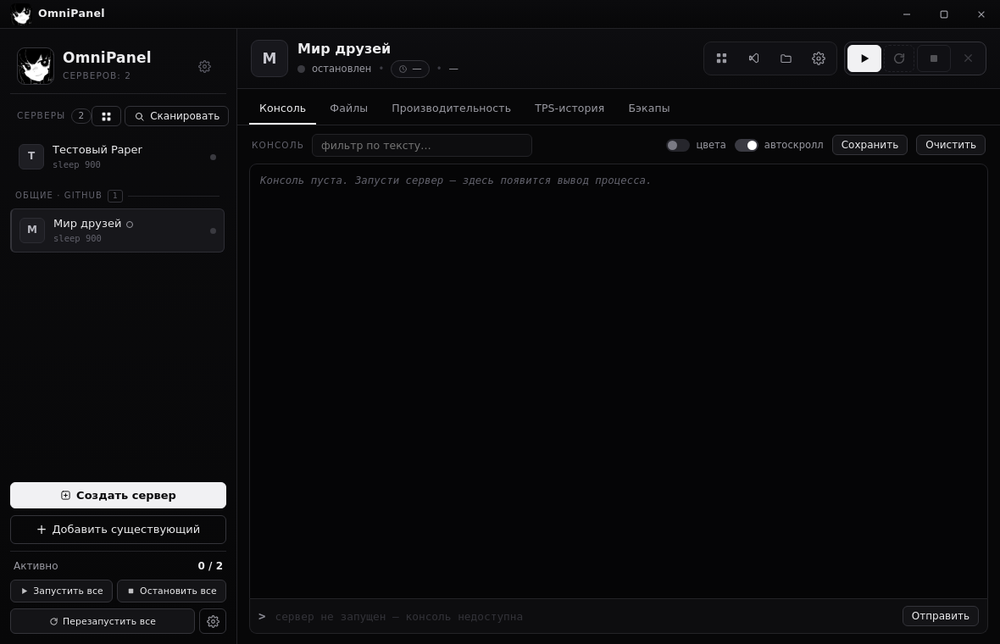

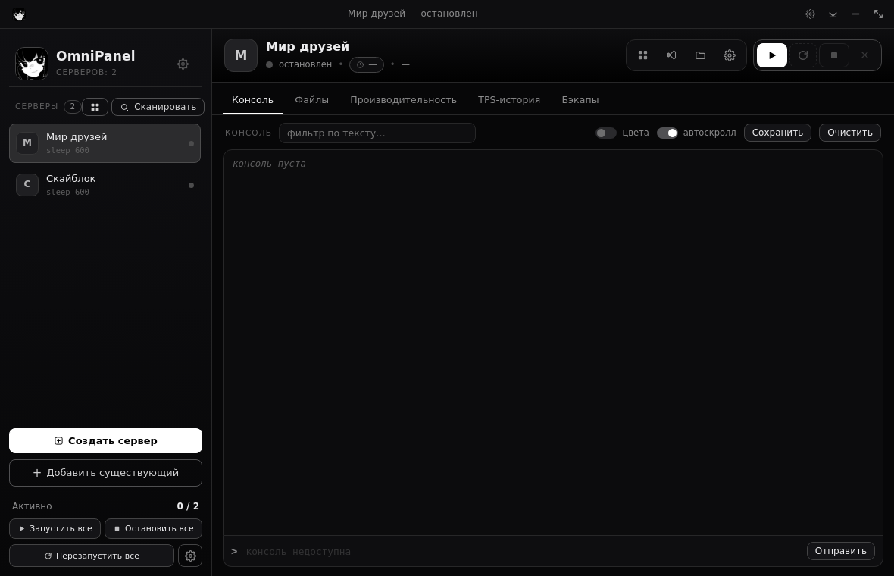

**OmniPanel** — локальная панель управления серверами для своего ПК: окно со списком серверов, кнопки **Старт / Стоп / Рестарт**, **живая консоль** и выбор папок через системный Проводник Windows. Файлы серверов остаются у тебя на диске — панель их не трогает, только запускает процессы.

**Открытый исходный код** (MIT): вся панель — это `main.js`, `core/` и `ui/`, без единой минифицированной зависимости. Установщик собирается из `installer/installer.c` тем же репозиторием.

**Вики для владельцев серверов и создателей аддонов** — [`docs/wiki`](docs/wiki) (публикуется на вкладку Wiki командой `GITHUB_TOKEN=… node tools/publish-wiki.js --repo Shokydo/OmniPanel`).

---

## 🖤 Установка одним exe (рекомендуется)

Файл: **[`OmniPanel-Setup.exe`](https://github.com/Shokydo/OmniPanel/releases/latest)** из раздела Releases — один файл, внутри уже лежит вся панель (~100 МБ).
Канал обновлений уже работает: `Shokydo/OmniPanel` → https://github.com/Shokydo/OmniPanel

1. Запусти exe. Откроется тёмное окно в духе консоли: что и куда ставится — и **кнопки внизу**, как в обычном установщике.
2. **«Установить»** — панель распакуется в `%LOCALAPPDATA%\OmniPanel` (права администратора не нужны). Папку можно поменять заранее кнопкой **«Изменить путь…»**.
3. Установщик сам создаст ярлыки на рабочем столе и в меню «Пуск», включит автообновление, а кнопкой **«Запустить панель»** откроется сама панель.

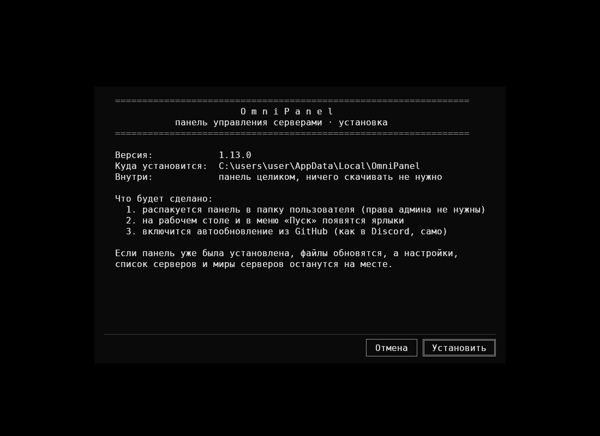

Вид консольный (чёрное окно, моноширинный шрифт, живой журнал установки), а управление обычное:

| Кнопка | Что делает |
|---|---|
| **Установить** | распаковать панель, ярлыки, автообновление |
| **Изменить путь…** | выбрать папку установки системным диалогом Windows |
| **Запустить панель** | открыть установленную панель |
| **Переустановить** | разложить файлы заново, данные останутся |
| **Открыть папку** | показать папку панели в Проводнике |
| **Перенести данные** / **Начать с чистых настроек** | если рядом нашлась старая `OmniPanelData` |
| **Закрыть** / **Отмена** | выйти из установщика |

Работает и мышью, и клавиатурой: `Enter` — главная кнопка, `Tab` — переход между кнопками, `Esc` — отмена.
Во время установки окно показывает полосу прогресса и журнал, закрыть его случайно нельзя.

**Повторный запуск этого же exe** ничего не переустанавливает — он показывает, что панель уже стоит, и предлагает **«Запустить панель»**. То есть файл работает и как установщик, и как ярлык.

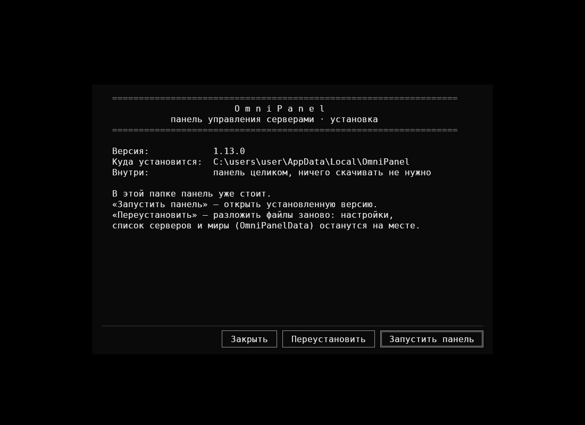

- Переустановить поверх (`--reinstall`) — обновит файлы панели, настройки и миры останутся.
- Удалить панель = удалить папку `%LOCALAPPDATA%\OmniPanel`.
- Дальше обновления приходят сами: панель смотрит в `Shokydo/OmniPanel` и ставит новые версии на месте.
- SmartScreen может предупредить о неподписанном exe: «Подробнее» → «Выполнить в любом случае».

### Своя папка установки

По умолчанию панель ставится в `%LOCALAPPDATA%\OmniPanel` — там не нужны права администратора.
Если хочется на другой диск или в свою папку:

1. На первом экране установщика нажми **«Изменить путь…»**.
2. Откроется обычный системный диалог Windows (**Проводник**, а не самодельное окно) — выбери папку, например `D:\Games`.
3. Установщик поставит панель в подпапку `OmniPanel` внутри выбранной: `D:\Games\OmniPanel`. Если выбрать папку, которая уже называется `OmniPanel`, он поставит прямо в неё.
4. Дальше всё как обычно — ярлыки, автообновление, кнопка «Запустить панель».

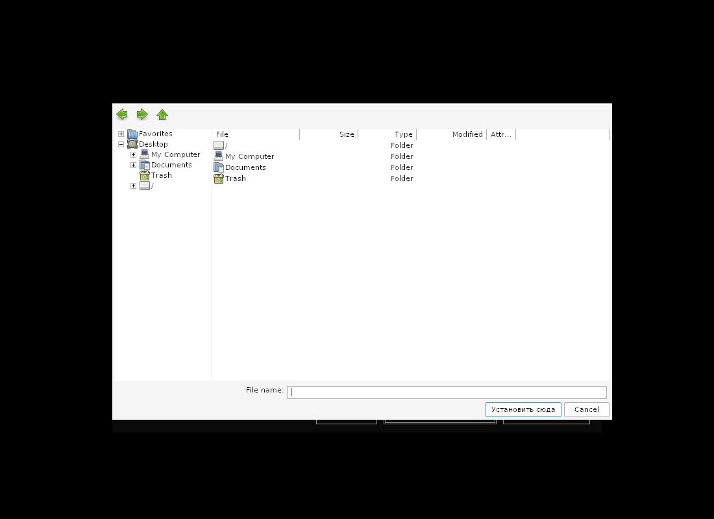

- **Путь запоминается.** Следующий запуск того же exe открывается уже с этой папкой, так что переустановка и обновления попадают туда же.
- **Забыть путь** — удалить файл `%LOCALAPPDATA%\OmniPanel-setup\install-path.txt`, вернётся стандартная папка.
- **Для скриптов:** `OmniPanel-Setup.exe --dir "D:\Games"` — тот же выбор без диалога, `--reinstall` — переустановить в ту же папку.
- **`Program Files` и `Windows`** — установщик заранее предупредит, что там нужны права администратора, и предложит выбрать другую папку.
- Данные (`OmniPanelData`) всегда лежат рядом с панелью — вместе с ней переезжают на другой диск и остаются при обновлении.

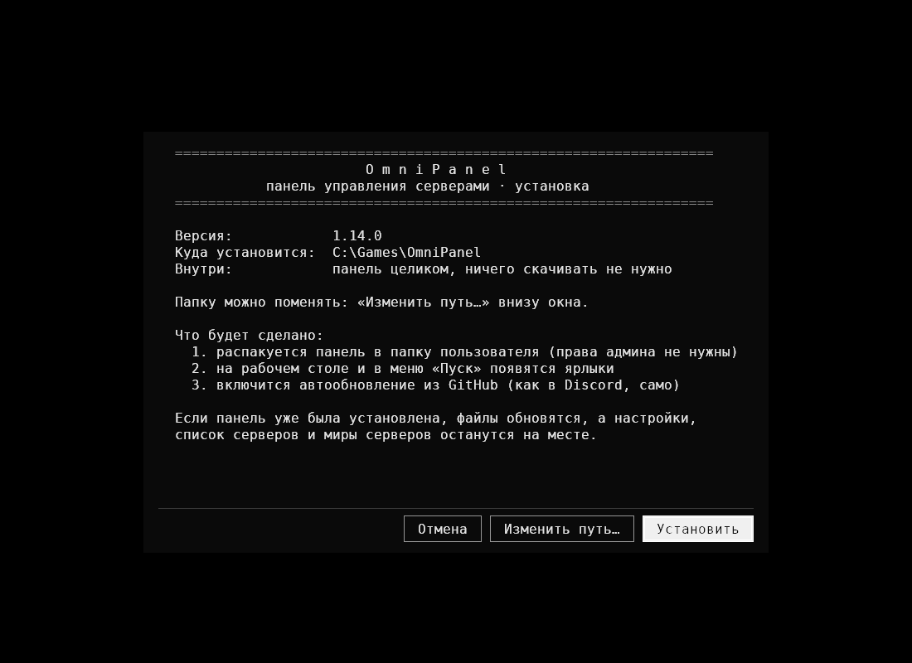

### При обновлении ничего не слетает

Обновление меняет **только файлы кода панели** (`resources/app`). Всё, что нажито работой, лежит рядом в `OmniPanelData`
и не трогается вообще:

| Что | Где | Переживает обновление |
|---|---|---|
| Список серверов, команды, пути к мирам | `OmniPanelData\servers.json` | да |
| Профиль и токен GitHub, настройки канала | `OmniPanelData\panel.json` | да |
| Оформление: тема, фон, масштаб, звуки | `OmniPanelData\Local Storage` | да |
| История TPS, бэкапы миров, логи | `OmniPanelData\tps`, `backups`, `logs` | да |
| Сами миры серверов | твои папки вне программы | да |

Плюс страховка в самом коде обновления:

- пути вида `OmniPanelData/...`, `data/...`, `servers.json`, `panel.json` **игнорируются**, даже если случайно окажутся в архиве обновления;
- перед заменой делается снимок настроек (`updates\backup\before-<версия>\_user-config`);
- если после обновления файл настроек пропал — он возвращается из снимка;
- вся прежняя версия кода копируется в `OmniPanelData\updates\backup\before-<версия>-<время>` (хранятся два последних бэкапа).

Если раньше панель работала из другой папки (portable-версия), установщик сам найдёт рядом `OmniPanelData`
с твоим `servers.json` и спросит, переносить ли их: кнопки **«Перенести данные»** и **«Начать с чистых настроек»**.

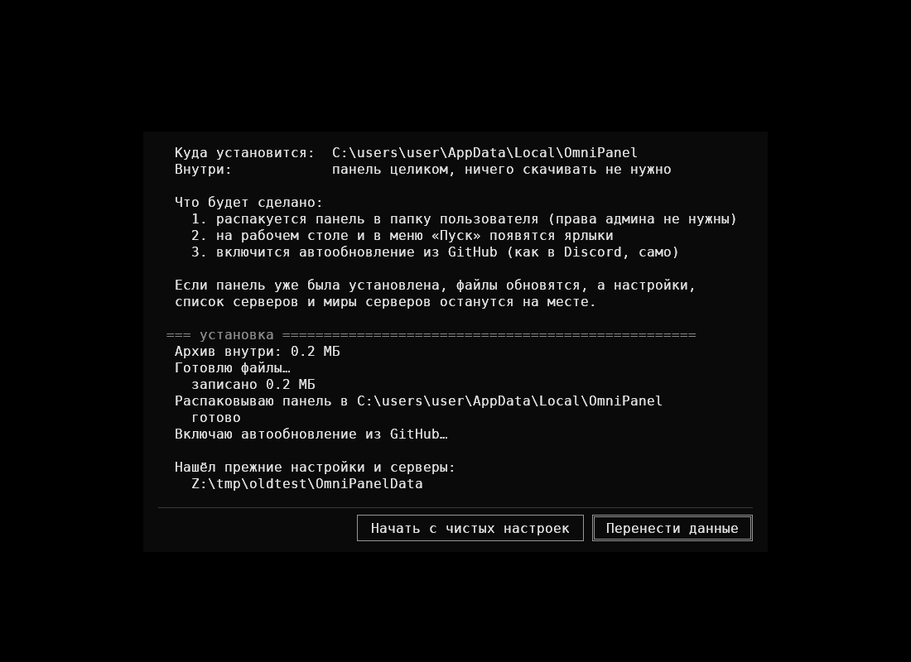

В каждом релизе лежит:

В релизе лежит **только установщик** — `OmniPanel_setup-<версия>.exe` (один файл, ~100 МБ, внутри вся панель).
Архив со сборкой больше не прикладывается: он нужен был только для ручной распаковки, а обновляется панель сама.

Собрать самому: `installer/build-all.sh` (нужны `mingw-w64` и `node`) — соберёт Windows-сборку, установщик и файлы обновления.

---

## 🚀 Быстрый старт: один exe

Файл: **`OmniPanel_setup-<версия>.exe`** (~100 МБ) из раздела Releases.

1. Запусти exe — установщик разложит панель и создаст ярлыки.
2. Дальше панель обновляется сама из GitHub (Настройки → Обновления, см. раздел ниже).

В exe-версии работают **все** функции: системный выбор папки сервера («обзор…»), выбор файла запуска («файл…»), открытие папки в Проводнике кнопкой **«Папка»**, трей, автозапуск, корректная остановка серверов при выходе.

Настройки серверов хранятся рядом с программой: `OmniPanelData\servers.json` — переносишь папку на другой ПК, настройки едут с ней.

> SmartScreen может предупредить о неподписанном exe: «Подробнее» → «Выполнить в любом случае».

---

## Что нового в 1.23.0 — GitLab и лечение ошибки GitHub «input was too large»

* **GitHub больше не спотыкается о 422.** GitHub отвечает `Sorry, your input was too large to
  process`, когда тело запроса слишком большое: base64 раздувает часть архива почти на треть.
  Теперь часть по умолчанию — **20 МБ** (было 45), а если GitHub всё равно отказал, панель
  **сама режет мельче** (20 → 10 → 5 → 2 → 1 МБ) и отправляет снова. В консоли видно:
  «GitHub не принял часть целиком — режу мельче: по 10 МБ…».
* **Второй провайдер — GitLab.** В настройках сервера появился выбор «Куда пересылать:
  GitHub / GitLab». У GitLab свой поток:
  * архив 7-Zip режется на части и заливается в **хранилище пакетов проекта**
    (`omnipanel-server/<дата>/`), поэтому нет ни лимита GitHub в 95 МБ, ни base64;
  * рядом лежит `manifest.json` с размерами и sha256 каждой части;
  * забор: находим свежий пакет → скачиваем части → сверяем суммы → распаковываем →
    **удаляем пакет из проекта** (чтобы проект не рос);
  * «отправлять нечего» работает по отпечатку папки (файлы, байты, самый свежий mtime),
    поэтому повторная отправка без изменений не тратит трафик.
* **Токен GitLab** — Personal Access Token с правом `api` (Settings → Access Tokens).
  Панель запоминает его в `panel.json` рядом с остальными настройками и в логи не пишет.
* Кнопка «Проверить» понимает провайдера: для GitLab показывает проект, наличие ветки и
  доступность хранилища пакетов.

## Что нового в 1.22.0 — игроки, блокировки и окна в дизайне панели

* **Системных окон больше нет.** Вопросы вида «синхронизация не удалась — запускать?» панель
  задаёт своим окном: тёмная тема, скругления, кнопки в один столбец. Если окно закрыто,
  панель падает обратно на системный диалог, чтобы вопрос не потерялся.
* **Игроки**: у каждого теперь режим игры (четыре на выбор — выживание, творческий, приключение,
  наблюдатель), «очистить» инвентарь, «убить», «кик» и «бан» (причина спрашивается своим окном).
* **Список обновляется сам** — переключатель «обновлять сам» включён: панель тихо спрашивает
  `list` каждые 20 секунд и сразу после запуска сервера. Никаких нажатий.
* **Новая вкладка «Блокировки»**: ник, UUID, IP, причина, кто забанил и до какого срока —
  и кнопка «Разбанить». Читается прямо из `banned-players.json` и `banned-ips.json`, поэтому
  работает и на остановленном сервере (тогда панель правит файл, на запущенном — снимает
  блокировку командой `unban` / `pardon-ip`).
* **TPS-график рисуется с первого замера**: первый опрос идёт через 1,5 секунды после запуска
  (повтор каждые 3 секунды, пока сервер не ответит), период по умолчанию — 10 секунд вместо 30.
  Одна точка уже видна точкой с подписью, а не надписью «данных пока нет».

## Что нового в 1.21.0 — архив делится на части, GitHub больше не упирается в 95 МБ

* **Отправка**: панель пакует сервер в 7-Zip и режет архив на части по **45 МБ** —
  `.omnipanel/сервер.7z.001`, `.002` … Каждая часть проходит лимит GitHub (95 МБ на файл),
  поэтому уехать может сервер на несколько гигабайт (до 90 частей).
* В репозитории рядом лежит `.omnipanel/манифест.json`: число частей, размеры и **sha256**
  каждой. По нему панель понимает «отправлять нечего», а при заборе проверяет каждую часть
  после скачивания.
* **Забор**: скачивает все части → сверяет контрольные суммы → распаковывает → **удаляет части
  и манифест из репозитория одним коммитом**, чтобы репозиторий не распухал. В консоли:
  «части архива удалены из репозитория (7)».
* Нужен архив в репозитории как копия — включи переключатель «оставлять части архива».
* **Плотнее бэкапы**: LZMA2 со словарём 64 МБ, 273 быстрых байта, твёрдый блок. Уже сжатые
  `.jar` и `.mca` сильнее не ужмутся — это предел формата, а не настройки.
* **«Лёгкий» бэкап** (включён): без `libraries`, `versions`, `logs` и `crash-reports` — их сервер
  восстанавливает сам. Мир, плагины, конфиги и ядро в архиве всегда.
* Перед сборкой архива панель пишет в консоль, что занимает место: «самое тяжёлое — world 1,3 ГБ,
  plugins 120 МБ».
* Бэкап из нескольких частей виден в списке **одной строкой** с числом частей; удаление чистит все тома.
* Если 7-Zip не нашёлся, а zip получился больше 95 МБ, панель не молчит: подсказывает положить
  `7za.exe` рядом или отправить по файлам.

## Что нового в 1.20.0 — пересылка на GitHub одним архивом

Раньше панель по умолчанию гоняла сервер по файлам. Теперь основной поток — архив:

* **Отправить на GitHub**: панель упаковывает папку сервера в `.7z` и кладёт в репозиторий один
  файл `.omnipanel/сервер.7z` + `.omnipanel/манифест.json`;
* **Забрать с GitHub**: скачивает этот файл и распаковывает обратно в папку сервера;
* оба шага видно и в строке состояния, и в консоли сервера: «шаг 1 из 2: архивирую…» →
  «шаг 2 из 2: отправляю архив на GitHub», «шаг 1 из 2: скачиваю архив…» → «шаг 2 из 2: распаковываю…»;
* архив 7z меньше, поэтому в лимит GitHub (95 МБ на файл) влезает больше миров;
* старые репозитории с `.omnipanel/сервер.zip` читаются как есть — при следующей отправке панель
  сама заменит zip на 7z;
* пофайловая отправка осталась: выключи переключатель «пересылать сервер одним архивом».

## Что нового в 1.19.4 — обновление сразу после релиза больше не падает

Причина ошибок «контрольная сумма не совпала» и «обновление не встало»: `raw.githubusercontent.com`
отдаёт файлы с кэшем в пять минут и игнорирует параметр-обходчик в адресе. Сразу после публикации
панель качала **предыдущий** архив, сумма не сходилась, и обновление обрывалось.

* `update.json` и архив кода теперь берутся через API GitHub и из релиза — там кэша нет;
* архив кода прикладывается к релизу, поэтому ссылка ведёт в хранилище ассетов, а не в raw;
* raw остался запасным путём, если API недоступен;
* контрольная сумма берётся из `update.json`, даже когда архив качается из релиза;
* если сумма всё равно не сошлась, панель молча качает второй раз по новому адресу;
* в окне обновлений видно «кэш GitHub отдал старую копию — качаю заново…».

## Что нового в 1.19.1 — бэкапы в 7z, максимальное сжатие

Бэкапы теперь собираются в **`.7z` (LZMA2, `-mx=9`, твёрдый блок)** — это заметно плотнее zip,
а на серверах с тысячами мелких файлов разница в разы. `7za.exe` (1,3 МБ) едет внутри панели:
ставить 7-Zip не нужно, интернет для архивации тоже.

* по умолчанию «Создать бэкап» делает `.7z`; в списке бэкапов видно формат;
* восстановление `.7z`, старых `.zip` и `.tar.gz` — одна кнопка, ничего не надо помнить;
* `.7z` открывается и в редакторе файлов: список содержимого, чтение файла без распаковки,
  «распаковать один файл» и «распаковать всё»;
* если 7-Zip почему-то не запустился, бэкап молча соберётся zip'ом — панель не оставит тебя без копии;
* в консоль пишется размер, из чего сжато и во сколько раз плотнее.

## Что нового в 1.19 — архивы, бэкапы одним архивом, TPS рядом с нагрузкой

- **Архивы открываются прямо в редакторе.** Клик по `.zip` (а также `.jar`, `.mcpack`) показывает **содержимое**: имя каждого файла и размер. Файл можно посмотреть, не распаковывая (`settings.yml` — сразу текстом, картинку — картинкой), распаковать по одному или весь архив кнопкой **«Распаковать сюда»** — папка появится рядом с архивом.
  - `.rar` и `.7z` панель честно не открывает: для них нужен внешний распаковщик, а тащить его в portable-сборку ради просмотра нерационально. Панель так и говорит.
- **Картинки открываются просмотрщиком.** `.png`, `.jpg`, `.gif`, `.webp`, `.bmp`, `.ico` показываются как изображение с шахматным фоном, а не «двоичный файл, редактирование недоступно».
- **Вкладки открытых файлов.** Раньше открывался один файл и терялся при переходе к другому. Теперь над редактором вкладки: **до 16 файлов** одновременно, у каждого свой курсор и прокрутка, несохранённое помечено, средний клик закрывает вкладку. Справа счётчик `3/16`.
- **Перетаскивание файлов между папками.** Тащишь файл или папку на другую папку в дереве — папка подсвечивается, файл переезжает. Бросить на пустое место дерева — уедет в корень сервера. Папку внутрь себя перенести нельзя.
- **Создание файла — только имя.** Больше не нужно писать `plugins/MythicShields/NewFile.yml`: в окне спрашивается имя, а место берётся из выбранной папки в дереве (и подписано прямо в окне). Если вписать путь — панель попросит выбрать папку слева.
- **Бэкапы жмутся по максимуму.** Архив собирает свой zip-писатель с `deflate` уровня 9 (максимум для zip) и не тащит содержимое в память: одинаково работает на Windows и Linux, без PowerShell. В архиве не нужны `.git`, `cache`, `session.lock`, `Thumbs.db`.
- **Список бэкапов обновляется сразу.** Раньше после «Создать бэкап» список выглядел прежним — теперь новый архив появляется в списке сам, с именем, временем и размером.
- **Синхронизация может гнать сервер одним архивом, как бэкап.** В блоке синхронизации появился переключатель **«гонять сервер одним архивом, как бэкап»**: весь сервер пакуется тем же максимальным сжатием и уходит в репозиторий одним файлом вместо десятков тысяч блобов. Быстрее на больших мирах и не упирается в лимит GitHub на размер файла. Отметить/снять можно в любой момент — режимы между собой совместимы, история хранится под `.omnipanel/`.
- **Ошибка 409 на пустом репозитории больше не появляется.** У репозитория без коммитов нет ни дерева, ни ветки, поэтому GitHub отвечает `409 Git Repository is empty` — и отправка падала. Теперь панель сама создаёт **первый коммит** через Contents API, получает ветку и повторяет отправку; служебный файл удаляется следующей отправкой. Текст ошибки стал честным: если 409 всё же случится, панель так и напишет — «репозиторий ещё пустой».
- **TPS-история переехала в «Производительность».** Отдельной вкладки больше нет: график TPS стоит под графиками CPU и RAM, рядом выбор периода и **таймер автообновления** (5 с / 15 с / минута / выключен) с обратным отсчётом. Там же — **команда сервера** и **период проверки** TPS, чтобы не искать их в настройках сервера.
- **Блок синхронизации переделан.** Сверху переключатель и заголовок **«Синхронизация всего сервера»** с пояснением: уходит мир, плагины, конфиги и ядро, а логи, кэш и бэкапы — нет. Ползунки вместо галочек, кнопки «Забрать с GitHub» / «Отправить на GitHub», строка состояния моноширинным текстом.
- **Масштаб-зум убран совсем.** Он сжимал всю раскладку: на маленьком окне текст становился нечитаемым, на большом оставались пустые поля. Теперь интерфейс **резиновый** — панели тянутся, вкладки переносятся, на узком окне блоки перестраиваются, а зума нет ни в настройках, ни в коде. Вместо него — «плотность» (плотнее / обычный / крупнее), которая меняет только размер строк и шрифта, не ломая раскладку.
- **Вики для создателей аддонов.** Markdown-страницы лежат в `docs/wiki` (манифест аддона, мост `postMessage`, методы и права, бэкапы, файлы). Публикация — `GITHUB_TOKEN=… node tools/publish-wiki.js --repo Shokydo/OmniPanel`.
- **Аддоны по-новому.** **«Мифические мобы»** стал вики + адаптацией кода и **по умолчанию выключен**: разделы «Вики» (моб, скилл, дроп, предмет, спавнер, триггеры с готовыми примерами), «Адаптация кода» (вставил код — панель заменила табуляцию, поправила `Skill:` на `Skills:`, добавила `Health` и `Type`, подставила путь файла и сохранила) и «Проверка файлов» (какие файлы MythicMobs кривые). **«Белый список»** остаётся включённым.


## Что нового в 1.18 — аддоны панели, вход в GitHub, масштаб

- **Аддоны как расширения у редакторов кода.** Любая функция теперь может жить отдельным аддоном: папка с `addon.json` и своей страницей. Аддон включается и выключается **переключателем** в новых настройках **«Аддоны»**, а его страница появляется отдельной **вкладкой у сервера** — рядом с консолью и файлами. Аддон не имеет прямого доступа к системе: он работает в изолированном окне и общается с панелью только через мост с разрешениями (`files`, `command`), поэтому видит лишь папку своего сервера.
  - Встроенные аддоны: **«Мифические мобы»** (список мобов MythicMobs, проверка YAML — табуляция, отсутствие `InternalName`, создание моба по шаблону, «Показать» и «Редактор») и **«Белый список»** (добавить игрока по нику с автоматическим поиском UUID, убрать, включить `white-list` в `server.properties`).
  - Свои аддоны кладутся в `OmniPanelData/addons` — кнопка «Открыть папку аддонов» прямо в настройках.
  - Пример `addon.json`:
    ```json
    {
      "id": "my-addon",
      "name": "Мой аддон",
      "version": "1.0.0",
      "description": "что делает",
      "permissions": ["files", "command"],
      "panel": { "title": "Мой аддон", "file": "panel.html" }
    }
    ```
- **Вход в GitHub по коду починен.** Раньше ожидание могло запуститься дважды: один опрос обрывался, второй продолжал висеть и каждые несколько секунд показывал «Вход не выполнен — нет данных для ожидания входа». Теперь опрос один, ошибка показывается **один раз**, ожидание останавливается само, а при обрыве связи панель пробует ещё пару раз, не обрывая вход.
- **«Вход по коду» и «Вход по токену» — две одинаковые кнопки в одной строке.** Строка токена раскрывается под ними.
- **Масштаб правда следует за окном.** В режиме «Под окно» интерфейс считается от окна 1120×700: маленькое окно сжимает интерфейс до 80 %, большое растягивает до 150 %, размер пересчитывается при каждом изменении окна и при выходе из полного экрана. Ручные 85 / 100 / 115 / 130 % остались.
- **Меньше пустоты.** Настройки панели и `server.properties` раскладываются в две колонки и заполняют ширину окна, а не жмутся к левому краю.
- **Вкладки не уезжают.** Вкладки сервера переносятся на вторую строку и не обрезаются, когда аддонов становится много.

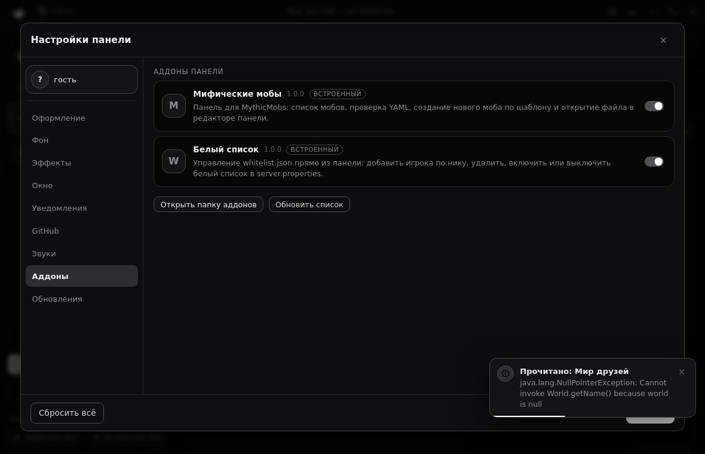
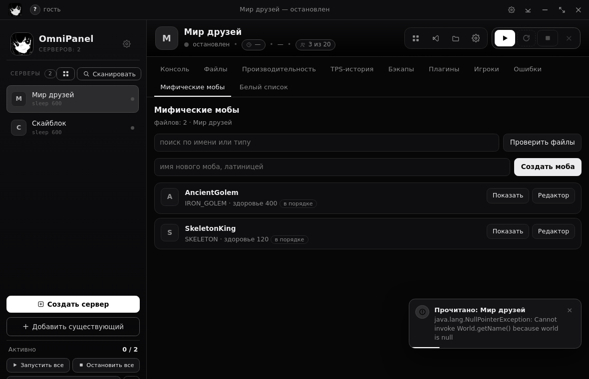
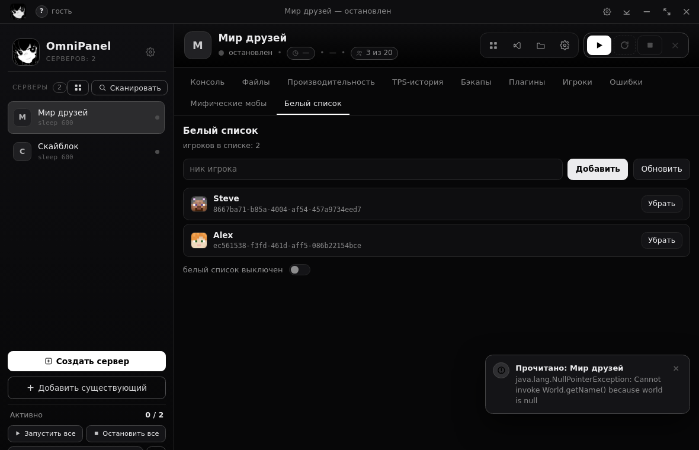

## Что нового в 1.17.1 — оболочка, масштаб и проверка портов

- **Плашка окна как в полном экране.** Своя шапка окна теперь ровно того же вида, что полоса F11: слева иконка, кнопка настроек и аккаунт, по центру «сервер — состояние», справа те же компактные кнопки: настройки, скрыть в трей, уменьшить, на весь экран, закрыть. Одним кликом по шапке окно разворачивается.
- **Масштаб интерфейса подстраивается под окно.** В «Окно → Масштаб интерфейса» появился пункт **«Под окно»** — он выбран по умолчанию: панель сама подбирает масштаб под размер окна и пересчитывает его при изменении размера. Ручные 85 / 100 / 115 / 130 % тоже остались.
- **Настройки стали шире и выше.** «Настройки панели» и «server.properties — все настройки» открываются почти на всё окно (до 1240×820) по центру, и целиком помещаются даже при масштабе 130 %.
- **Поля больше не выпихивают кнопки за край.** В окне «Новый сервер → Из GitHub» кнопка «обзор…» у поля «Куда скачать» оставалась за границей окна — теперь поле сжимается, а кнопка на месте. Окно добавления сервера стало выше, а подвал с кнопками переносит их на новую строку, если места мало.
- **Проверка портов перед запуском.** Если у запускаемого сервера порт уже занят — другим работающим сервером панели или другой программой на компьютере — панель показывает окно **«Порт занят»**: кто именно держит порт, сразу подсвеченный свободный порт и кнопки **«Сменить и запустить»** / «Всё равно» / «Отмена». Новый порт записывается прямо в `server.properties` (server-port, query.port, rcon.port — с учётом того, включены ли query и RCON).

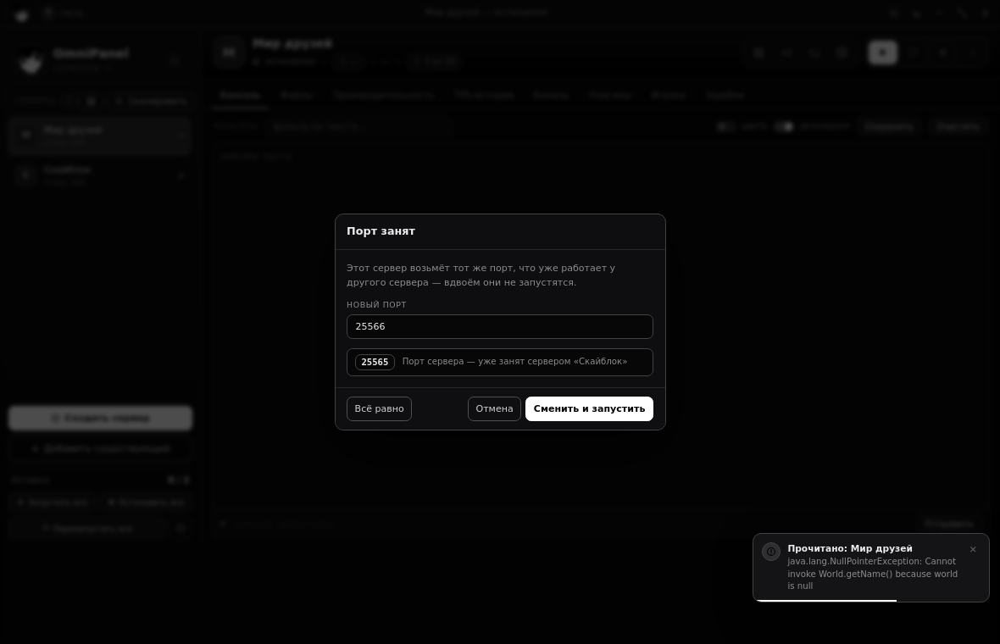
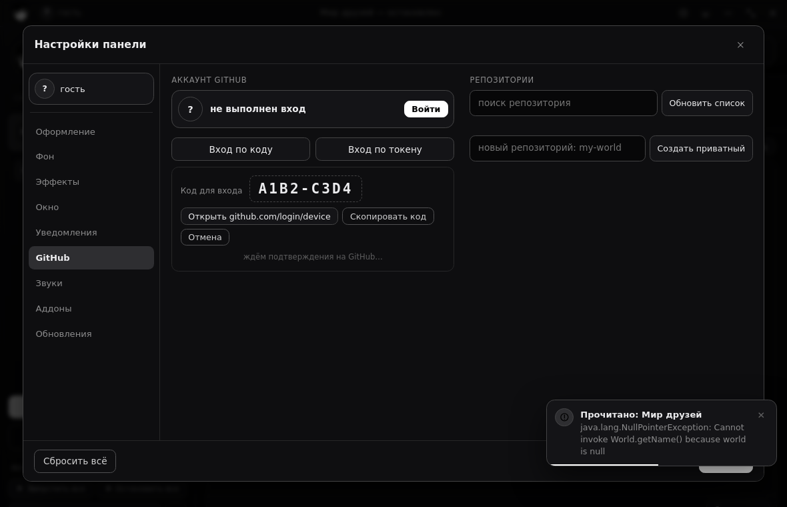

## Что нового в 1.17 — плагины с Modrinth, игроки, ошибки, перетаскивание файлов

> Актуальная сборка — **1.23.0**.

- **Плагины и моды прямо с Modrinth.** Новая вкладка **«Плагины»** у сервера: поиск, иконки проектов, число загрузок, автор и версия. Фильтры — тип (плагин / мод / датапак), версия игры и загрузчик (Paper, Spigot, Bukkit, Purpur, Folia, Fabric, Forge, NeoForge, Quilt). Кнопка **«Установить»** скачивает нужный jar сразу в `plugins/` или `mods/` этого сервера; версия и загрузчик определяются по самой папке сервера.
- **Перетаскивание файлов в «Файлах».** Тащишь файлы из проводника в панель — рамка цвета акцента показывает край окна, а папка в дереве подсвечивается, если бросить прямо в неё. Файл кладётся в открытую папку сервера, повторы и ошибки показываются уведомлением.
- **Сканер ошибок.** Новая вкладка **«Ошибки»**: панель читает логи при запуске и разбирает их на ошибки, падения, предупреждения и выход с ненулевым кодом. Повторы склеиваются в одну строку со счётчиком `×N`, стек показывается рядом, кнопка **«Скопировать»** переносит текст в буфер. У новой ошибки на вкладке появляется счётчик, уведомление мерцает; как только вкладку открыли — счётчик спадает, мерцание прекращается.
- **Онлайн игроков.** Вкладка **«Игроки»**: кто сейчас на сервере, головы с mc-heads.net, кнопка «Кик». Онлайн (`N из M`) виден прямо в шапке сервера и обновляется по логам (`joined the game`, `lost connection`, `There are N of a max of M players online`) и по ответу на команду `list`.
- **TAB в консоли.** Начни печатать `/gi` — появится список команд, а после команды подсказываются ники игроков, которые сейчас онлайн. Стрелки выбирают, `Tab`/`Enter` подставляют.
- **Цвета из фона.** В оформлении появилась кнопка **«Цвета из фона»**: панель считает палитру по выбранным обоям (средний тон, самый насыщенный оттенок) и собирает из неё тему — фон, панели, границы, текст, акцент.
- **Кнопки карточки сервера выровнены.** Строка CPU/RAM больше не «съезжает» при остановленном сервере (показываются прочерки), а «Старт», «Стоп» и «Папка» всегда стоят на одной линии и одной высоты.
- **Все углы скруглены по ролям** — кнопки 8, карточки 12, панели 16; в новых вкладках нет ни одного прямого угла.
- **Вход в GitHub по коду работает сразу.** В устройство-флоу вшит публичный Client ID: открывается код вида `A1B2-C3D4`, свой OAuth App создавать не нужно. Свой Client ID по-прежнему можно указать в настройках, если хочется.

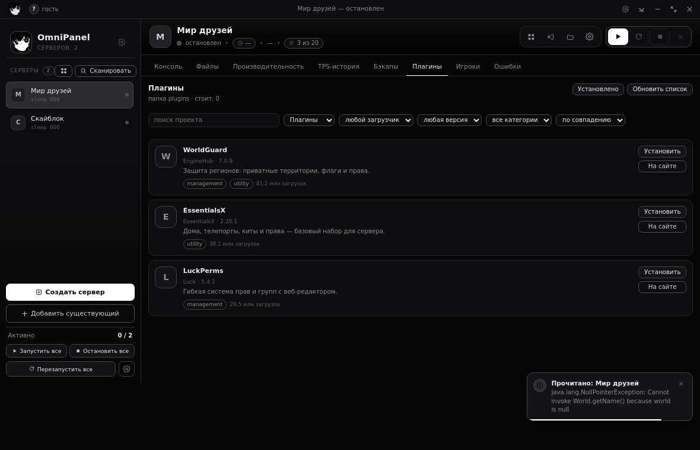
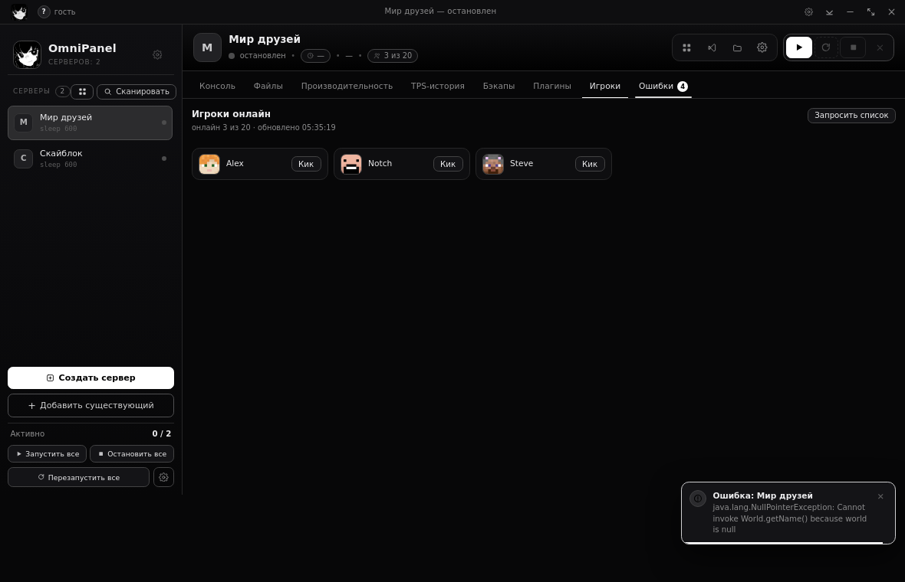
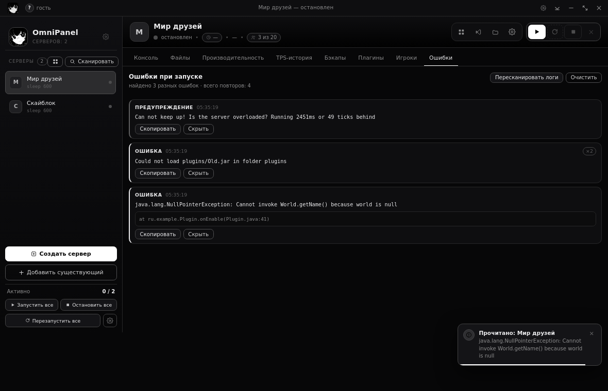
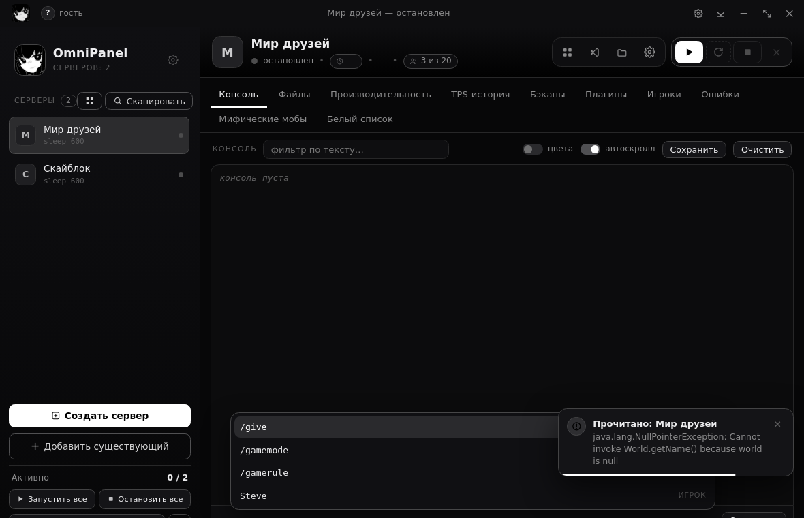
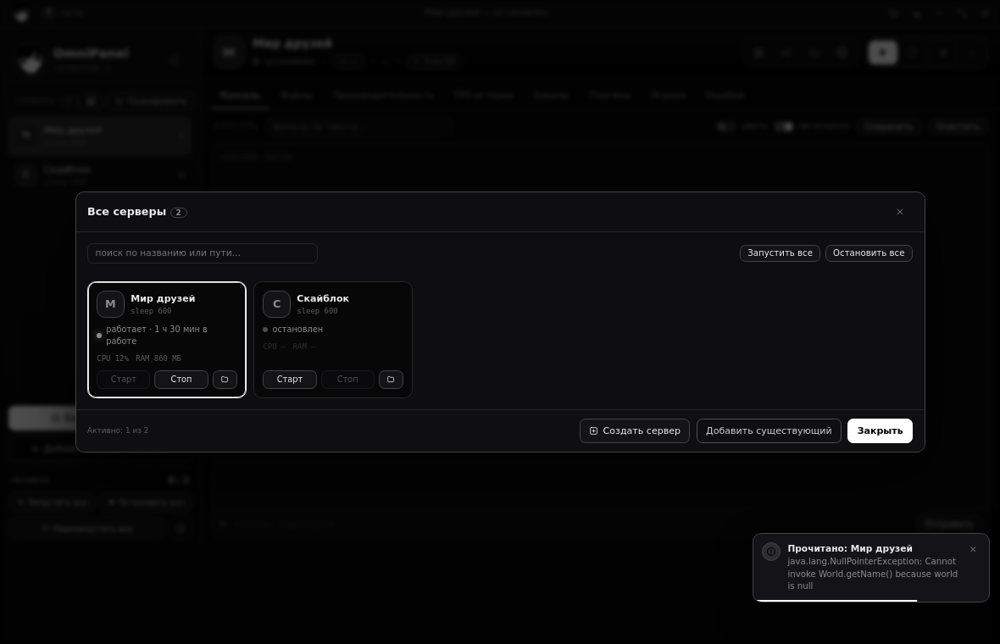

## Что нового в 1.16 — окно, темы, эффекты, аккаунт в шапке

> Актуальная сборка — **1.23.0**. Ставить вручную нужно один раз: дальше панель обновляется сама.

- **Своя шапка окна как в полном экране** — справа четыре кнопки: **скрыть в трей**, **уменьшить**, **развернуть**, **закрыть**. Крестик закрывает панель, а если что-то запущено — сначала спрашивает и не рвёт серверы молча.
- **Настройки больше не дёргаются** — окно фиксированного размера: переключение вкладок не меняет высоту, прокручивается только содержимое.
- **17 готовых тем** — тёмные (Тёмная, Графит, Контраст, Серый, Ночь, Океан, Лес, Аметист, Закат, Уголь, Сталь) и светлые (Светлая, Бумага, Снег, Мята, Песок) плюс «Кастом». Каждая тема собирается из четырёх цветов, поэтому акцент перекрашивает весь интерфейс: кнопки, ползунки, дорожки, выделение.
- **«Кастом» — настоящий конструктор.** Панель своих цветов видна только на этой теме: фон, панели, границы, текст, второстепенный текст, выделение, основная кнопка и её текст, второстепенная кнопка и её текст, значки. Свою тему можно сохранить в пресеты.
- **Эффекты от клика прямо на экране** — волна, точка, кольцо или крест в точке нажатия (или выключить совсем).
- **Пять наборов звуков** — мягкие, механические, колокольчики, низкие, поп.
- **Аккаунт GitHub в шапке** — значок профиля рядом с названием панели, профиль слева сверху в настройках и кнопка **«Войти»** прямо у знака вопроса.
- **Обновления проверяются постоянно** — не только при запуске, а каждые 20 минут; новость мерцает плашкой в шапке и точкой на вкладке «Обновления».
- **Без подсказок** — из интерфейса убраны пояснялки, наставления и всплывающие «нажми сюда».
- **Никаких упоминаний чужих программ** — тексты и код говорят только про OmniPanel; кнопка открытия папки во внешнем редакторе называется «Редактор».
- **Оформление по сетке 4 px** — единые отступы, радиусы по ролям (кнопки 8, карточки 12, панели 16), один акцент на тему, без цветных свечений и градиентного текста.

| Шапка окна | Темы |
| --- | --- |
| 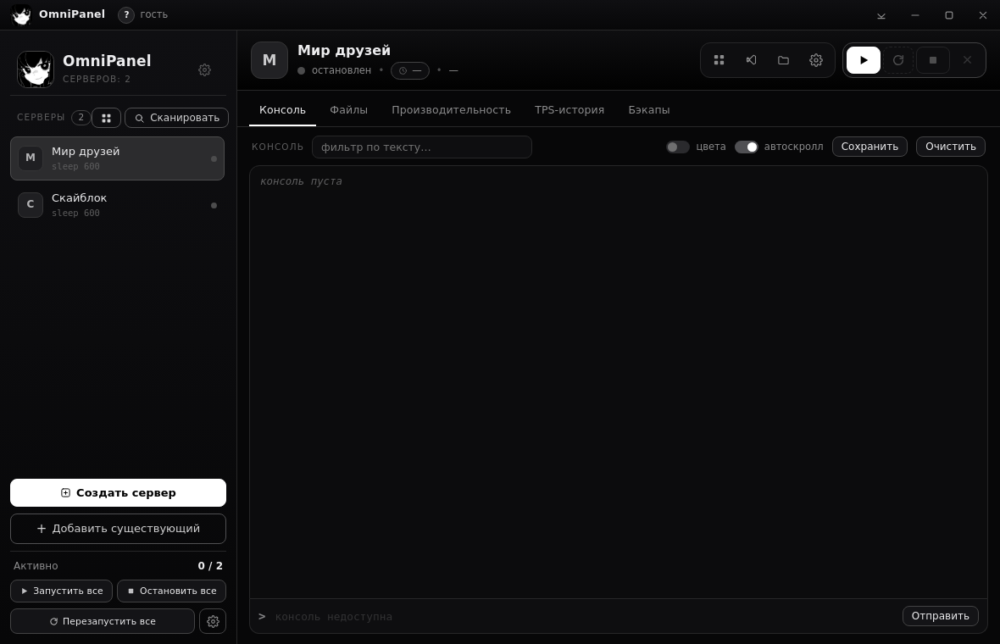 | 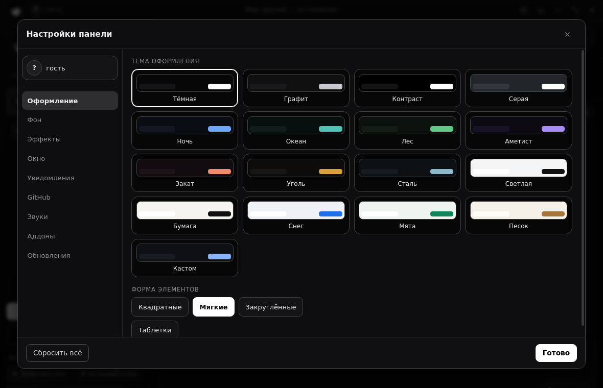 |

| Своя тема | Эффект от клика |
| --- | --- |
| 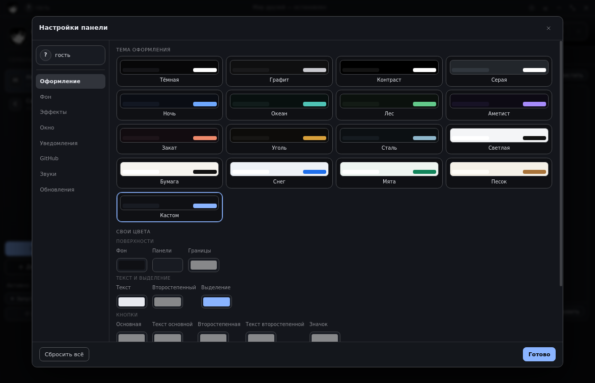 | 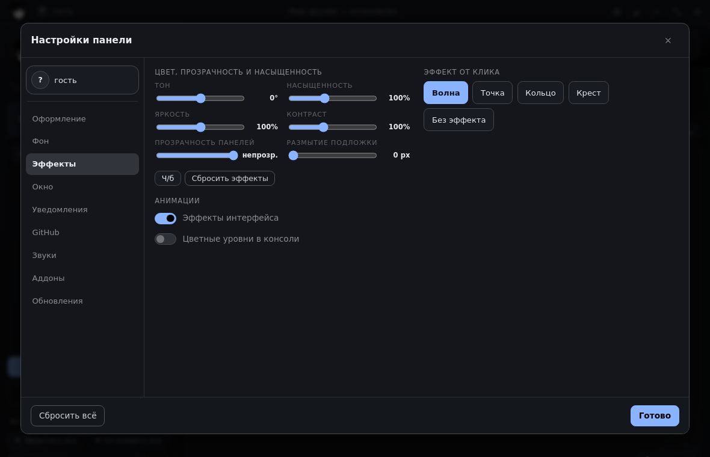 |

---

## 1.15 — полные настройки, вход в аккаунт, полный экран

- **server.properties целиком** — 64 параметра в семи разделах: основное, мир, игроки и правила, сеть и доступ, ресурспаки, производительность, логи и отладка. Плюс раздел «Свои ключи» — параметры плагинов и модов тоже правятся. Кириллица пишется как `\uXXXX`, комментарии и незнакомые строки не трогаются.
- **Добавить сервер двумя способами** — «Локальный» (папка на диске) и «Из GitHub»: выбор репозитория из своего аккаунта или вход по токену, скачивание архива ветки, автоподбор команды запуска и привязка синхронизации.
- **Вход в аккаунт GitHub по коду** — панель показывает код, ты подтверждаешь его на `github.com/login/device`, токен сам ложится в настройки. Вход по токену остался запасным вариантом.
- **Полный экран (F11)** — сверху полоса: слева иконка, по центру «Сервер — запущен/останавливается + время работы», справа три маленькие кнопки (настройки, свернуть, выйти из полного экрана).
- **Иконка сервера** — итог всегда 1:1, и масштаб со смещением теперь реально попадают в готовый `server-icon.png` (раньше сдвиг терялся).
- **В релизах только установщик** `OmniPanel_setup-<версия>.exe` — архив сборки больше не прикладывается.


### Полные настройки server.properties

В окне сервера у блока `server.properties` появилась кнопка **«Все настройки…»**: слева разделы, справа поля, сверху поиск по названию или по ключу.

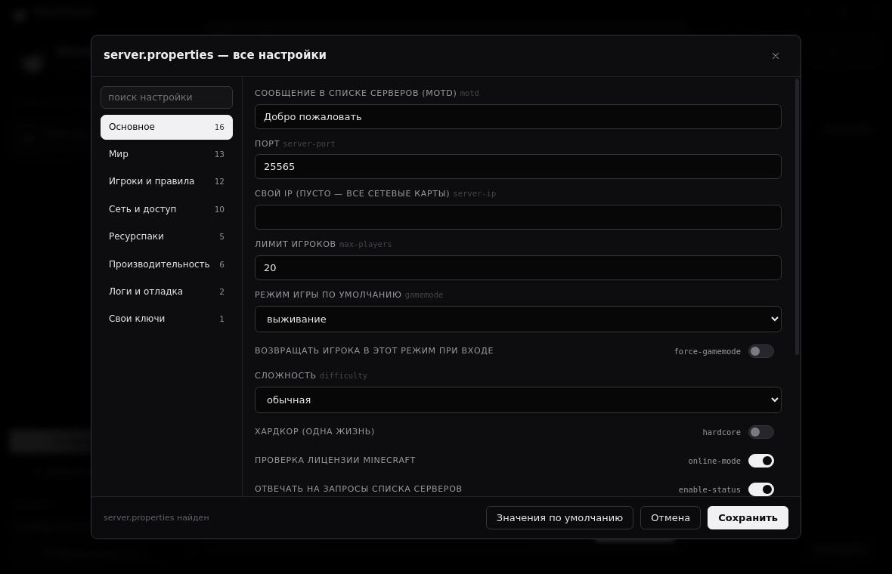

- Меняются только те строки, которые ты тронул — остальные остаются как были, вместе с комментариями.
- Булевы параметры — переключатели, а не галочки.
- Числа проверяются по допустимым границам (порт 1–65535, дальность прорисовки 2–32 и так далее).
- Кнопка **«Значения по умолчанию»** подставляет стандарты Minecraft, **«Сохранить»** пишет файл.
- Ключи плагинов (`my-plugin-key=custom`) попадают в раздел «Свои ключи» — их тоже можно править.

### Добавление сервера: локальный или из GitHub

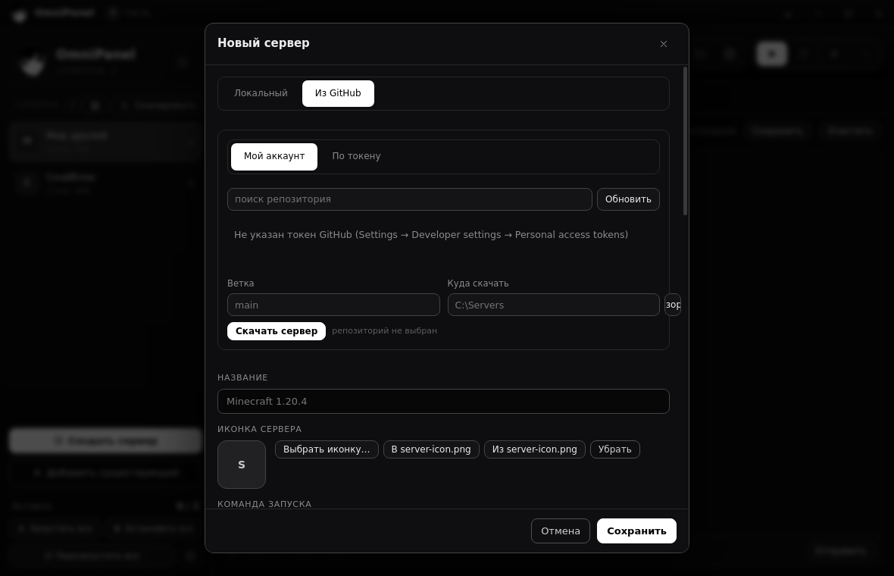

1. **Локальный** — как раньше: своя папка, команда запуска, файлы уже на диске.
2. **Из GitHub** — «Мой аккаунт» (список репозиториев подгружается сам) или «По токену» (свой токен на один раз).
3. Выбери ветку и папку, нажми **«Скачать сервер»** — панель заберёт архив репозитория (мир, плагины, конфиги, ядро), разложит по папке, подберёт команду запуска по найденному `.jar` и сразу привяжет синхронизацию к этому репозиторию.

### Вход в аккаунт GitHub по коду

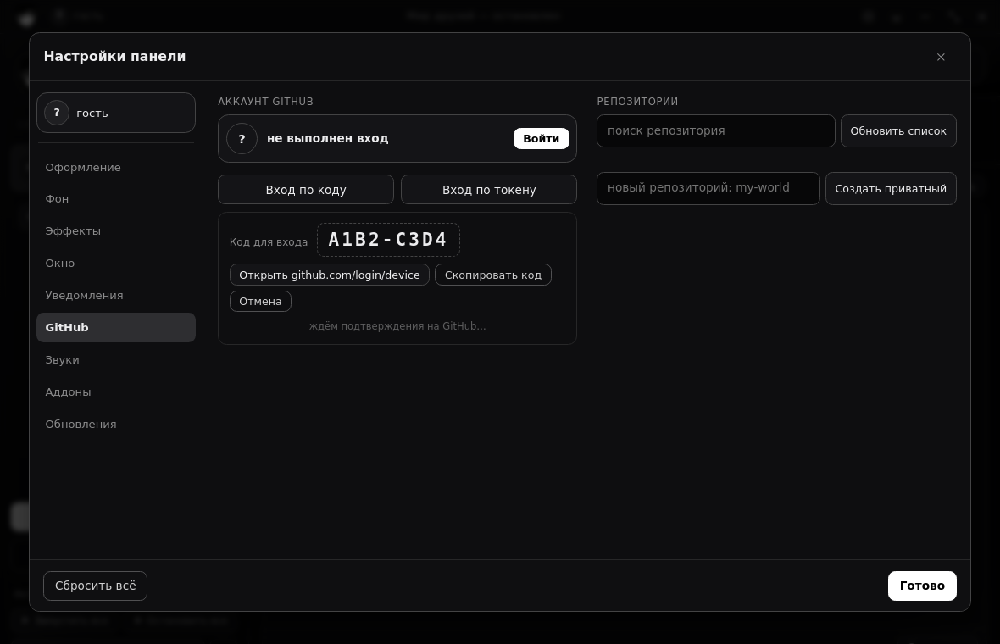

1. Настройки → **GitHub** → **«Войти через GitHub»**.
2. Панель покажет код вида `A1B2-C3D4` и сама откроет `github.com/login/device`.
3. Введи код на сайте, подтверди — панель подхватит вход автоматически (проверяет раз в несколько секунд).

Один раз нужно указать **Client ID** своего OAuth App — это делает владелец сборки:

- GitHub → Settings → Developer settings → **OAuth Apps** → *New OAuth App*;
- поставить галочку **Enable Device Flow**, остальные поля — любые;
- скопировать **Client ID** и вставить в панели (или прописать в `main.js` в константу `GITHUB_OAUTH_CLIENT_ID`, чтобы поле не показывалось вовсе).

Вход по токену никуда не делся — он за кнопкой «Вход по токену».

### Полный экран: полоса состояния

В F11 своя шапка окна убирается, вместо неё сверху тонкая полоса:

| Где | Что |
|---|---|
| слева | иконка панели |
| по центру | `Мир друзей — работает · 1 ч 12 м` / `останавливается` / `остановлен` |
| справа | три маленькие кнопки: настройки, свернуть, выйти из полного экрана |

## Что нового в 1.14 — своя папка установки

> Актуальная сборка — **1.14.0**. Ставить вручную нужно один раз: дальше панель обновляется сама.

- **Кнопка «Изменить путь…»** в установщике: системный диалог Windows, ставим куда угодно — `D:\Games\OmniPanel`, другой диск, флешку.
- **Путь запоминается** — переустановка и следующий запуск exe идут в ту же папку.
- **`--dir "D:\Games"`** для установки без диалога; про `Program Files` установщик предупреждает заранее.
- Запасной способ распаковки, если `tar` в системе не сработал.

## Что нового в 1.13 — установщик с настоящими кнопками

> Версия с кнопочным установщиком консольного вида.

- **Установщик остался консольным по виду** — тёмное окно, моноширинный шрифт, живой журнал установки, полоса прогресса.
- **Но управление обычное:** кнопки внизу окна (Установить, Запустить панель, Переустановить, Открыть папку, Перенести данные, Закрыть). Мышь, `Enter`, `Tab`, `Esc` — всё работает.
- Окно больше не «висит» во время распаковки: установка идёт в фоне, журнал дописывается построчно.

## Что нового в 1.12 — открытый код и автообновление

> Первая версия с открытыми исходниками и автопереустановкой на месте.

- **Исходники открыты** (MIT) — этот репозиторий и есть панель, а не архив: можно читать файлы прямо на сайте, форкать и собирать самому.
- **Автообновление без вопросов** — панель сама скачивает `~1,1 МБ` кода и перезапускается. Если работают серверы — не мешает им и встаёт при закрытии.
- **В релизах — установщик** `OmniPanel-Setup-<версия>.exe`, качать больше нечего.

Больше не нужно каждый раз качать архив целиком. Панель смотрит в твой публичный репозиторий и, если там есть версия новее, предлагает обновиться.

- **Код обновляется на месте.** С GitHub скачивается маленький архив (`~1,2 МБ` вместо `105 МБ`), распаковывается поверх файлов программы, панель перезапускается сама. Перед заменой старые файлы копируются в бэкап.
- **Само, без вопросов.** Включено по умолчанию: панель через пару секунд после старта тихо проверяет канал, скачивает обновление и перезапускается на новой версии. Никаких кнопок и перекачивания архива. Если в этот момент работают серверы — обновление скачается и встанет при закрытии панели, чтобы не рвать работу.
- **Проверка при запуске.** Можно оставить только уведомление (тумблер «Ставиться автоматически» выключен) — тогда панель покажет «доступно обновление» и точку на вкладке «Обновления».
- **Кнопка «Проверить обновления»** — вручную, в любой момент.
- **Полная сборка (новый exe) — по кнопке.** Она большая (`105 МБ`), поэтому качается только когда нужна: рядом с папкой программы появляется `Обновить-OmniPanel.bat`, запуск которого закрывает панель, распаковывает новую сборку и запускает её.
- **Запущенные серверы не пострадают:** пока хотя бы один сервер работает, обновление не ставится на ходу — оно дождётся закрытия панели и встанет на выходе. Следующий запуск будет уже новой версией.

### Как настроить канал (один раз)

1. Создай **публичный** репозиторий на GitHub — по умолчанию панель смотрит в `Shokydo/OmniPanel`.
2. Панель → **Настройки → Обновления** → репозиторий и ветка `main` уже подставлены, оставь включённым «Проверять обновления при запуске».
3. Готово.

### Как выкладывать новую версию

**Вариант «два клика».** В папке проекта:

```
node tools/make-update.js --notes "что нового в этой версии"
```

(на Windows — `7-Собрать-обновление.bat`). Появится набор **`dist/OmniPanel-обновление-<версия>.zip`**:
распакуй его и запусти **`Залить-обновление.bat`** — скрипт возьмёт токен из настроек панели
(Настройки → GitHub), зальёт `update.json` и архив кода в репозиторий и создаст релиз `v<версия>`.
Если токена в панели нет — `Залить-обновление.bat --token ghp_…`.

Полную сборку скрипт приложит к релизу сам, если положить `OmniPanel-win64.zip` в папку `dist` рядом.

> Токену нужны **права на запись**: fine-grained → *Repository access* → *Contents: Read and write*; классический → галочка `repo`. С токеном «только чтение» GitHub ответит `Resource not accessible by personal access token`.

**Вариант вручную** — что куда кладётся:

| Файл | Куда | Зачем |
|---|---|---|
| `update.json` | в корень репозитория | версия, размеры, контрольные суммы |
| `dist/OmniPanel-code.zip` | в папку `dist` репозитория | тот самый архив обновления кода |
| `dist/OmniPanel-win64.zip` | **файлом к релизу** `v<версия>` | полная сборка (в обычные файлы репозитория 105 МБ не влезут — лимит 100 МБ) |

В репозитории должно получиться так:

```
update.json
dist/OmniPanel-code.zip
```

GitHub → Releases → *Draft a new release* → тег `v<версия>` → приложить `dist/OmniPanel-win64.zip` → Publish. Панель найдёт и код (по `update.json`), и сборку (по файлу релиза).

### Что происходит при обновлении

1. Панель читает `update.json` из ветки и (если есть) последний релиз — берёт то, что новее.
2. Качает код, сверяет контрольную сумму.
3. Копирует текущие файлы в `OmniPanelData\updates\backup\before-<версия>-<время>` (хранятся два последних бэкапа).
4. Раскладывает новые файлы, удаляет то, чего в новой версии больше нет, и перезапускается.
5. Если что-то пошло не так — старая версия лежит в папке бэкапа: кнопка «Папка бэкапов» в настройках обновлений открывает её.

> Токен для проверки обновлений не нужен: репозиторий публичный. Если закрыть репозиторий — панель возьмёт токен из вкладки «GitHub» в настройках.

---

## Что нового в 1.10 — полный сервер в GitHub, вход в аккаунт, настройки по категориям

**Синхронизация всего сервера.** Режим по умолчанию — «весь сервер»: мир, плагины, конфиги **и ядро** (`server.jar`, `paper.jar`, jar-файлы плагинов). Логи, крэш-репорты, `session.lock` и архивы (`zip/tar/gz/7z`) по-прежнему не отправляются. Если ядро в репозитории не нужно — оставь один из прежних режимов: «мир + конфиги плагинов» или «только мир».

**Вход в GitHub одной кнопкой.** Настройки панели → вкладка **GitHub**: вставь личный токен (с правами `repo`) → **Войти**. Дальше:
- панель подгружает **список твоих репозиториев** (приватные и публичные, с пометкой «только чтение»), есть поиск по названию;
- **клик по репозиторию** сразу подставляет его в настройки синхронизации сервера;
- кнопка **«Создать приватный»** заводит новый репозиторий, не выходя из панели;
- токен аккаунта подхватывается во всех серверах: отдельное поле «Свой токен» в настройках сервера теперь необязательно.

**Настройки панели по категориям.** Модальное окно разбито на 7 вкладок: Оформление · Фон · Эффекты · Окно · Уведомления · GitHub · Звуки. Внутри:
- **Оформление** — темы, свои цвета, **сохранение темы под своим названием** (пресеты с удалением в один клик), форма элементов.
- **Фон** — обои, «свой файл», **история недавних фонов** (последние 8 — в один клик обратно), вписывание и размытие.
- **Окно** — режим запуска, автозапуск с Windows, **масштаб интерфейса** (мельче / обычный / крупнее / крупно).
- **Уведомления** — тумблеры всплывающих и системных уведомлений, мягкий звук, **сколько держать на экране** (2/4/7 секунд).
- **Звуки** — тумблер, громкость и кнопки проверки («Щелчок», «Успех», «Ошибка», «Переход»).

**Все галочки стали переключателями.** Никаких чекбоксов-квадратиков: вкл/выкл — тумблер, который подсвечивается акцентом темы.

**Глубина сканирования — кнопка.** Вместо выпадающего списка — кнопка с иконкой папки: щелчок переключает 4 → 5 → 7 → 10 уровней, справа точками видно текущую ступень. Значение запоминается.

**Кракозябры в логах исправлены по-настоящему.** Раньше строки вида `╟руЁєцхэю ЄЁшуухЁют яЁефьхЄют: 0` появлялись, когда cp1251-байты принимались за cp866 (псевдографика `─│┼` в кириллическом диапазоне). Определение кодировки теперь штрафует такие «тексты», а уже испорченные строки дополнительно проходят через восстановление: `╟руЁєцхэю ЄЁшуухЁют яЁефьхЄют: 0` → `Загружено триггеров предметов: 0`. Декоративные рамки `════` при этом не ломаются.

---
## Что нового в 1.9 — синхронизация серверов через GitHub

Сценарий: друг поиграл на своём ПК, выключил сервер — мир сам уехал в приватный репозиторий. Ты запускаешь сервер позже: панель **проверяет GitHub, скачивает изменения и только потом стартует** — ровно та версия мира, на которой закончил друг.

### Как включить
1. Создай **приватный** репозиторий на GitHub (например `friend/minecraft-world`).
2. GitHub → Settings → Developer settings → Personal access tokens → сгенерируй токен с галочкой **repo**.
3. Панель → Настройки сервера → **Синхронизация с GitHub**: включи, впиши `владелец/репозиторий`, ветку (`main`), токен.
4. Выбери, **что** синхронизировать: только мир · мир + конфиги плагинов · всю папку сервера.
5. Кнопка **«Проверить»** — тест доступа; **«Отправить»** — первый коммит; **«Скачать»** — забрать изменения вручную.

### Что происходит дальше
- **Перед запуском** сервер получает свежий коммит из GitHub (только изменённые файлы — не весь мир), в консоль пишется, сколько скачано и удалено.
- **После корректной остановки** панель сама отправляет мир обратно — новым коммитом. При выходе из программы автоматической отправки нет: она бы попала в «догоняющую» загрузку.
- Такие серверы показываются **отдельной группой «Общие · GitHub»** в сайдбаре и **исключены из кнопок «Запустить все / Остановить все / Перезапустить все»** — чтобы случайно не перезапустить чужой мир. Для них в контекстном меню есть «Обновить из GitHub и запустить», «Скачать изменения», «Отправить на GitHub».
- Логи, крэш-репорты, `session.lock` и архивы не синхронизируются. С версии 1.10 режим «весь сервер» включает и ядро, и jar-файлы плагинов.
- Никакого `git` на компьютере не нужно: используется GitHub API. Конфликты не сливаются — «кто последний отправил, тот и прав».

### Перенос папки сервера в папку программы
Настройки сервера → **«Папка программы»** → **«Перенести сюда»**: папка копируется в `server/имя_сервера` рядом с `OmniPanel.exe`, путь сервера обновляется, исходную папку можно удалить сразу после копирования. Удобно, когда мир кочует между ПК вместе с флешкой.

## Что нового в 1.8.1

- В **полноэкранном режиме** (F11 или «Окно при запуске → На весь экран») своя шапка окна с названием и кнопками **свернуть / развернуть / закрыть** полностью скрывается — на экране остаётся только рабочая область.
- Выход из полного экрана — **F11** или **Esc**; при возврате в окно шапка появляется снова.

## Что нового в 1.8

- **Профиль в сайдбаре.** Над списком серверов — блок с иконкой, крупным именем **OmniPanel** и строкой «активно N из M»; шестерёнка рядом открывает настройки.
- **Компактная шапка сервера.** Кнопки стали иконочными и разбиты на две группы: слева — **все серверы · редактор · папка · настройки**, справа, в своей рамке — **запуск · перезапуск · стоп · принудительно**. Ничего не расползается при узком окне.
- **Фон панели.** Настройки → «Фон панели»: 8 готовых ч/б обоев (Аврора, Сетка, Волны, Горы, Точки, Шум, Штрихи, Пятна) **и свой файл** — PNG / JPG / WEBP / **GIF** / **MP4** / WEBM. Видео тихо зацикливается на фоне (кнопки «Звук» и «Пауза»), картинка вписывается «заполнить / вписать / растянуть / плиткой», есть размытие фона.
- **Цвет, прозрачность и насыщенность.** Ползунки: тон (−180…180°), насыщенность, яркость, контраст, **прозрачность панелей** (фон просвечивает через сайдбар, шапку, консоль, модалки) и **размытие подложки** (эффект стекла). Кнопка «Ч/б» мгновенно обесцвечивает интерфейс.

## Что нового в 1.7

- **Название — OmniPanel.** exe, окно, трей, заголовки и данные (`OmniPanelData`) переименованы; старая папка с прежним именем подхватывается автоматически при первом запуске.
- **Своё окно.** Стандартная рамка Windows убрана: собственная тонкая шапка с кнопками **свернуть · развернуть/восстановить · закрыть в трей**, перетаскивание за шапку, двойной клик по шапке — развернуть, `F11` — полный экран, `Ctrl+W` — в трей.
- **Режим при запуске.** Настройки → «Окно при запуске»: **в окне**, **развёрнутое**, **на весь экран**. Выбор сохраняется и применяется при следующем старте.
- **Время работы.** В шапке сервера — счётчик «0 мин 12 с» с иконкой часов, обновляется каждую секунду, отдельно по каждому серверу.
- **Кнопки «со всеми».** Внизу сайдбара: **Запустить все · Остановить все · Перезапустить все** и маленькая кнопка настроек рядом.
- **Все переключатели переехали в настройки**: звуки, эффекты, цветные уровни консоли, громкость, автозапуск вместе с Windows.
- **Окна уведомлений.** Всплывающие карточки с заголовком, иконкой типа (готово · ошибка · внимание · инфо) и полосой таймера; кнопка закрытия, клик — действие. Когда окно свёрнуто в трей, те же события приходят системными уведомлениями Windows.

## Что умеет

| | |
|---|---|
| **Старт / Стоп / Рестарт** | one-click, без батников. Стоп сначала пробует вежливо (`stop` в консоль), потом убивает |
| **Убить процесс** | принудительное завершение всего дерева процессов (`taskkill /T /F`) |
| **Живые логи** | stdout/stderr в реальном времени, цвета по типу строки, фильтр, автоскролл, сохранение в `.txt` |
| **Отправка команд** | пишешь в поле внизу — уходит в stdin процесса (как в консоль Minecraft) |
| **Выбор путей** | «обзор…» / «файл…» — системные диалоги Windows; автокавычки для путей с пробелами; проверка, что папка существует |
| **Открыть папку** | кнопка «Папка» в шапке — сервер в Проводнике Windows |
| **Трей** | закрыл окно — серверы работают. Правый клик по иконке → управление любым сервером |
| **Автозапуск** | «Автозапуск при старте панели» и «перезапускать при падении» — отдельно для каждого сервера |
| **Любой тип сервера** | `.bat`, `.exe`, `java -jar`, `node`, `python` — просто команда + рабочая папка |
| **Uptime и PID** | видно, сколько сервер уже работает |
| **ПКМ по серверу** | остановить · перезапустить · принудительно выключить · открыть папку · настройки · удалить |
| **Удаление с двойным подтверждением** | два отдельных окна, второе с формулировкой «Да, удалить навсегда» |
| **Свои иконки** | «Выбрать иконку…» — PNG/JPG/ICO/WEBP, редактор с масштабом, поворотом и **смещением по X/Y**, кнопка «В server-icon.png» |
| **GitHub-синхронизация** | мир уезжает в приватный репозиторий после остановки и приезжает перед запуском; общие серверы — в отдельной группе |
| **Перенос папки** | «Перенести сюда» → `server/<имя>` рядом с программой, с удалением старой папки |
| **Свой фон** | ч/б обои в комплекте + свой PNG/GIF/MP4; прозрачность, стекло, тон, насыщенность, яркость, контраст |
| **Кодировки вывода** | автоопределение UTF-8 / CP866 / CP1251 — кириллица в консоли больше не превращается в «�������» |
| **Цветная консоль** | уровни строк (ERROR/WARN/DEBUG/INFO) подсвечиваются; тумблер «цвета» переключает монохром ⇄ цвета |
| **TPS-монитор** | для Minecraft: панель периодически шлёт `tps` в консоль и показывает значение + мини-график |
| **Настройки server.properties** | в окне настроек сервера: MOTD, порт, лимит онлайна, сложность, режим игры, дальность прорисовки, online-mode, pvp, white-list, hardcore и другие — правится прямо из панели |
| **Иконка с кадрированием** | свой аватар: зум, поворот, перетаскивание кадра; кнопка «В server-icon.png» пишет 64×64 в папку сервера |
| **Редактор** | кнопка «Редактор» открывает папку сервера (и любой файл из файлового менеджера) во внешнем редакторе кода; поиск идёт по `PATH` и типовым местам установки, а если редактор не найден — путь открывается системным приложением |
| **Создание сервера в один клик** | кнопка «⚡ Создать сервер»: выбор ядра (Paper, Folia, Purpur, Fabric, Forge, NeoForge, Vanilla, Velocity, Waterfall, своя ссылка), версии, Java, памяти и флагов — панель сама скачивает jar и генерирует `start.bat`, `eula.txt`, `server.properties` |
| **Редактор файлов** | вкладка «Файлы»: дерево папки сервера, правка конфигов с подсветкой YAML/JSON/свойств, сохранение по Ctrl+S, шпаргалка MythicMobs и MythicCrucible со вставкой шаблонов |
| **Сканер серверов** | находит папки серверов на дисках и предлагает «Добавить» / «Открыть папку» |
| **Автозапуск с Windows** | тумблер «Старт с Windows» в сайдбаре |
| **Эффекты** | мягкие звуки кликов и клавиш (синус, без резких щелчков), волна на кнопках, ползунок громкости |
| **Графики CPU/RAM** | вкладка «Производительность»: графики в реальном времени по всему дереву процессов сервера |
| **Бэкапы** | вкладка «Бэкапы»: zip-архив папки сервера и загрузка обратно в один клик, со страховочным снимком |
| **История TPS** | вкладка «TPS-история»: график за 15 мин / 1 ч / 6 ч / 24 ч, история живёт на диске |
| **Темы** | тёмная, светлая, серая, контрастная и «Кастом» с выбором своих цветов |
| **Форма элементов** | квадратные / мягкие / закруглённые / таблетки — применяется ко всему интерфейсу: кнопкам, полям, карточкам, меню, модалкам, тумблерам, скроллбарам |

---

## Вариант 2: запуск из исходников (для правок кода)

1. Нужен **Node.js LTS** — [nodejs.org/ru](https://nodejs.org/ru). Проверь: в консоли `node -v`.
2. Склонируй репозиторий и зайди в папку:
   `git clone https://github.com/Shokydo/OmniPanel.git` → `cd OmniPanel`
3. `npm install` — поставит Electron (1–3 минуты, нужен интернет).
4. `npm start` — откроется окно панели. Иконка появится в трее.

### Пересобрать exe самому

`installer/build-all.sh` (Windows: `installer/make.sh`) соберёт установщик в `build\` — тот же, что в релизах. Сборка идёт из этого же кода, пересобирать нужно только после правок.

---

## Красивости: ПКМ, иконки, звуки

- **Правый клик по серверу в списке** — быстрое меню: Остановить / Перезапустить / Принудительно выключить / Открыть папку / Настройки / Удалить. Недоступные пункты (например «Остановить» у выключенного сервера) подсвечены серым.
- **Удаление** спрашивает дважды: первое окно «Удалить сервер?», второе — «Точно удалить?» с кнопкой «Да, удалить навсегда». Файлы на диске при этом не трогаются.
- **Иконки**: Настройки → «Выбрать иконку…». Подойдёт PNG/JPG/ICO/WEBP, картинка сохраняется в 128×128 (без «жатости»), хранится прямо в `servers.json` (base64) — переносится вместе с конфигом. Кнопка **«server-icon.png»** забирает картинку прямо из папки сервера, а при открытии настроек панель делает это автоматически, если иконки ещё нет. Для Minecraft это родной `server-icon.png` — тот же, что видят игроки в списке серверов.
- **Дизайн** — чёрно-белый монохром. В консоли ошибки выделены белым на подложке и жирным, предупреждения — пунктиром, debug — серым. Тумблер **«цвета»** в панели консоли возвращает цветную схему, если монохрома мало.
- **Звуки и эффекты** — тумблеры в настройках. Звуки синтезируются на лету (без mp3-файлов): отдельные тона на клик, старт, стоп, печать, пять наборов на выбор. Эффект от клика — волна, точка, кольцо или крест прямо в точке нажатия.

## Кракозябры в консоли («�������»)

Причина: Java/консольные программы Windows пишут вывод в кодировке **CP866** (а иногда CP1251), а панель по умолчанию читала UTF-8. Теперь кодировка определяется автоматически по первым строкам с кириллицей (UTF-8, CP866 и CP1251 сравниваются по «похожести на текст»), а в настройках сервера можно задать её вручную:

| Ситуация | Что выбрать |
|---|---|
| Обычный Minecraft (Paper/Spigot/Forge) | **Авто** |
| Старые плагины/моды, батники Windows | **CP866** |
| Логи в Windows-1251 | **CP1251** |
| Linux-сервер, UTF-8 | **UTF-8** |

После старта сервера в консоли появляется строка вида `ℹ Кодировка вывода определена как CP866` — по ней видно, что сработало.

С 1.10 каждая строка дополнительно проверяется на «двойное перекодирование»: если текст похож на cp1251-байты, прочитанные как cp866 (это те самые `╟руЁєцхэю`, `яЁефьхЄют`), он автоматически восстанавливается в нормальную кириллицу.

## TPS в панели — да, можно

Для Minecraft есть встроенный монитор: в настройках сервера поле **«TPS-монитор»** (по умолчанию `tps`, интервал 30 с). Панель сама отправляет команду в консоль, ловит ответ и показывает **TPS** в шапке рядом с uptime, вместе с мини-графиком последних замеров, а значение ниже 15 подчёркивается.

Поддерживаются ответы:
- Paper/Spigot: `TPS from last 1m, 5m, 15m: 19.8, 19.9, 20.0`
- Forge/NeoForge: `Mean TPS: 20.000`
- старый Forge: `... : 20.000 TPS`

Если у тебя не Minecraft — в поле можно указать любую команду, в ответе которой встречается `TPS` или `Mean TPS`.

## Создание сервера в один клик

Кнопка **«⚡ Создать сервер»** в сайдбаре (и на пустом экране). Панель сама скачает нужный jar по прямой ссылке с официального API ядра и подготовит папку сервера — вручную искать файлы не нужно.

**Шаг 1. Ядро.** Список сгруппирован:

| Группа | Ядра | Для чего |
|---|---|---|
| Оптимизированные | **Paper**, **Folia**, **Purpur** | серверы с плагинами Bukkit/Spigot; Paper — самый популярный выбор |
| Моды | **Fabric**, **Forge**, **NeoForge** | модпаки; Forge/NeoForge ставятся своим установщиком (несколько минут) |
| Официальные | **Vanilla** | чистый сервер от Mojang |
| Прокси | **Velocity**, **Waterfall** | сеть из нескольких серверов, `online-mode` не нужен |
| Другое | **Своя ссылка** | любой jar по прямой http(s)-ссылке |

**Шаг 2. Версия.** Список подтягивается в реальном времени: Paper — PaperMC API v3, Purpur — свой API, Vanilla — манифест Mojang, Fabric — Fabric Meta, Forge/NeoForge — promotions/maven. Рядом с версией видно, какая Java нужна.

**Шаг 3. Куда создать.** «обзор…» открывает системный диалог Windows, имя папки подставляется автоматически (`paper-1.21.4`). Порт, название в панели и MOTD правятся тут же.

**Шаг 4. Java.** Панель ищет Java сама: `PATH`, `JAVA_HOME`, `C:\Program Files\Java`, `Eclipse Adoptium`, `Amazon Corretto`, `Microsoft\jdk`, `Zulu`, `BellSoft`. Если версия ниже нужной — подсказка об этом скажет, а кнопка **«где взять Java?»** открывает страницу Adoptium Temurin. Кнопка **⟳** переискивает Java после установки.

**Память и флаги.** `-Xms`/`-Xmx` в мегабайтах, набор флагов JVM:

- **Aikar** (по умолчанию) — рекомендованные флаги G1GC для Minecraft;
- **Простые G1GC** — короткий набор;
- **Без флагов**;
- **Свои** — поле для любых своих `-XX`.

**Что появляется в папке:**

| Файл | Что внутри |
|---|---|
| `paper-1.21.4-232.jar` (или другой) | скачанный jar ядра |
| `start.bat` | `chcp 65001`, `cd /d "%~dp0"`, `java -Xms… -Xmx… <флаги> -jar "…" nogui`, `pause` (на Linux/macOS — `start.sh`) |
| `eula.txt` | `eula=true` — сервер сразу стартует без ручного подтверждения |
| `server.properties` | порт, MOTD, `online-mode`, `max-players`, `difficulty` |

Путь к Java с пробелами подставляется в кавычках, кириллица в MOTD экранируется в `\uXXXX` — старые версии Minecraft читают `server.properties` в ISO-8859-1 и иначе показали бы «кракозябры».

Во время создания показывается полоса прогресса с процентами и объёмом («52,7 из 52,7 МБ») и журнал шагов. Готовый сервер сразу добавляется в панель с командой запуска `start.bat`, командой остановки `stop` и включённым TPS-монитором — остаётся нажать **«Старт»**.

Про Forge/NeoForge: панель скачивает установщик и запускает `java -jar forge-installer.jar --installServer` в папке сервера — для этого нужна Java подходящей версии, поставленная **до** создания. Готовый `run.bat` становится командой запуска.

## Редактор файлов

Вкладка **«Файлы»** в шапке сервера (или ПКМ по серверу → «Файлы сервера»). Править `server.properties`, `config.yml` плагинов, конфиги MythicMobs можно не выходя из панели — Проводник и внешний редактор больше не нужны для мелочей.

**Слева — дерево папки сервера.** Папки раскрываются по клику, у файлов виден размер и тип. ПКМ по элементу: открыть, создать файл внутри папки, переименовать, удалить, открыть в Проводнике (в exe-версии). Кнопки **«+ файл»** и **«+ папка»** создают элементы (путь можно писать с подпапками, например `Skills/Frost.yml` — папки создадутся сами). Поле «найти файл…» ищет по именам внутри папки сервера.

**Справа — редактор.** Подсветка синтаксиса для `.yml`, `.json`, `.properties`, `.js`; нумерация строк, отступ по Enter с сохранением текущего, Tab = 2 пробела, `Ctrl+S` — сохранить. Внизу — путь, позиция курсора, тип и размер файла. Если в файле есть несохранённые правки, панель помечает это точкой и не даёт молча потерять их (спросит перед открытием другого файла).

Двоичные файлы (`.jar`, `.mca`, картинки) открываются «только для чтения» с пометкой — редактор их не портит. Файлы больше 2 МБ не открываются (логи лучше смотреть в консоли). Всё ограничено папкой сервера: выйти за её пределы нельзя, символические ссылки наружу тоже отсекаются.

### Шпаргалка MythicMobs / MythicCrucible

Кнопка **«Шпаргалка»** открывает справа боковую панель с готовыми шаблонами — она же включается сама, когда открываешь файл из `plugins/MythicMobs`:

| Раздел | Что внутри |
|---|---|
| Моб | `Type`, `Display`, `Health`, `Options`, `Equipment`, `Skills`, `Drops` |
| Предмет | `Id`, `Model` (CustomModelData), `Lore`, `Enchantments`, `Attributes` |
| Навык | механики, цели `@target`/`@PIR`, триггеры `~onAttack` |
| Дропы | шансы, диапазоны количества, столы дропа |
| Спавнер | `RandomSpawns` + команды `/mm s create` |
| **MythicCrucible** | мебель (`Type: FURNITURE`, `Barriers`, `Seats`, `Lights`, `States`, `FurnitureSkills`) |
| **Блок (Crucible)** | `Type: BLOCK`, `BlockSkills` |
| Команды | `/mm reload`, `/mm m spawn`, `/mm i get`, `/mm s create`, `/mm debug` |

Кнопка **«Вставить»** вставляет шаблон в позицию курсора, **«Новый файл по шаблону»** создаёт файл по правильному пути (`plugins/MythicMobs/Mobs/MyMob.yml`). Полная документация — [wiki.mythiccraft.io](https://wiki.mythiccraft.io).

## Иконка сервера: свой аватар

В настройках сервера у иконки появился редактор:

- **«Выбрать иконку…»** — картинка из файла, сразу открывается редактор;
- **масштаб** (ползунок или колесо мыши над превью), **поворот** от −180° до 180°, **перетаскивание кадра** мышью;
- **«Применить»** — результат 128×128 подставляется в список и шапку;
- **«В server-icon.png»** — записывает текущую иконку в папку сервера как `server-icon.png` 64×64 (её показывает Minecraft в списке серверов);
- **«Из server-icon.png»** — обратная операция: взять картинку из папки сервера.

## Настройки server.properties

В том же окне, ниже — блок **server.properties**. Читаются реальные значения из файла сервера, правятся только те поля, которые ты изменил, остальные строки файла (включая комментарии и незнакомые ключи) остаются на месте.

| Поле | Ключ |
|---|---|
| MOTD | `motd` (пишется с экранированием в `\uXXXX`, как это делает сам Minecraft) |
| Порт | `server-port` |
| Лимит онлайна | `max-players` |
| Сложность | `difficulty` |
| Режим игры | `gamemode` |
| Дальность прорисовки | `view-distance` |
| Галочки | `online-mode`, `pvp`, `allow-flight`, `white-list`, `hardcore`, `enable-command-block` |

Кнопка **«Перечитать»** загружает значения заново (например, если файл правили руками или сервер их перезаписал при остановке).

## Открыть в редакторе

Кнопка **«Редактор»** в шапке сервера открывает его папку во внешнем редакторе кода; в файловом менеджере — кнопка «Внешне» открывает текущий файл. Панель ищет бинарник редактора в `PATH` и в типовых местах установки, а если редактор не найден — открывает путь системным приложением и честно пишет об этом.

## Сканер серверов


Кнопка **«⌕ Сканировать»** в сайдбаре. Проходит диски (глубина выбирается кнопкой с иконкой папки: 4 / 5 / 7 / 10 уровней, по умолчанию 5; системные папки, `node_modules`, `Program Files` и прочее пропускаются) и находит:

- **Minecraft** — по `server.properties`, `eula.txt`, `server.jar`/`paper.jar`, папкам `plugins`/`mods`/`world`; сразу подставляет `stop` как команду остановки и включает TPS-монитор;
- **Node.js** — по `package.json` + `index.js`/`bot.js`/`app.js`;
- **Python** — по `requirements.txt` + `main.py`/`bot.py`;
- **.exe/.bat** — по типичным именам (`start.bat`, `server.exe`).

**Фильтр «Что ищем»** (чипы в окне сканера): Minecraft-сервер, Node.js, Python, exe-приложения, скрипты (bat/sh), папки плагинов. По умолчанию включены только первые три, потому что:

- `.exe`-поиск раньше цеплял обычные приложения (`server.exe` от антивируса, `start.exe`, апдейтеры);
- папки с плагинами (`Downloads` с `BetterModel.jar`, `libs`, `plugins`, `mods`) принимались за серверы.

Теперь это исправлено:

- папка считается **сервером Minecraft** только если есть реальные маркеры сервера — `server.properties`, `eula.txt`, `bukkit.yml`/`spigot.yml`/`paper.yml`, `ops.json`, `whitelist.json` или jar именно сервера (`server.jar`, `paper.jar`, `spigot.jar`, `purpur.jar`, `fabric-server-launch.jar`, …). Наличие одного лишь `BetterModel-1.14.2-paper.jar` в `libs` — не сервер;
- `libs`, `lib`, `libraries`, `plugins`, `mods`, `world*`, `datapacks` не сканируются вглубь;
- папки, где лежат только jar-файлы, помечаются как **«плагины»**, показываются отдельным чипом и **не добавляются** (кнопка «не сервер»);
- exe рядом с `unins000.exe`, `uninstall.exe`, `updater.exe`, `setup.exe`, `crashreport*.exe` отбрасывается как приложение.

Каждая находка — карточка с путём, типом и «подсказками» (что именно нашлось), кнопками **«Добавить»** и **«Открыть папку»**. Есть «Добавить все» (плагины пропускает). Сама панель из результатов исключена.

## Производительность, бэкапы, история TPS

В шапке сервера теперь четыре вкладки:

**Консоль** — как раньше, плюс цветные уровни и мягкие звуки.

**Производительность.** Две карточки с графиками: **CPU** (сумма по дереву процессов сервера, в процентах от одного ядра) и **RAM** (суммарный RSS всех дочерних процессов), плюс счётчик процессов. Замер раз в 2 секунды. На Linux читается из `ps`, на Windows — через PowerShell/WMI, поэтому внешние утилиты не нужны.

**TPS-история.** График по сохранённым замерам, диапазон переключается (15 мин / 1 ч / 6 ч / 24 ч), сверху — текущее, среднее, минимум и максимум. История пишется на диск (`OmniPanelData/tps`), поэтому не теряется при перезапуске панели. Кнопка «Очистить историю» удаляет замеры сервера.

**Бэкапы.** «Создать бэкап» пакует рабочую папку сервера в zip (Windows: встроенный `Compress-Archive`; Linux: `tar.gz`) в `OmniPanelData/backups/<id сервера>/`. У каждого архива видны дата и размер, есть «Восстановить» и «Удалить».

Что происходит при восстановлении:
1. сервер останавливается (команда остановки, при необходимости — kill);
2. автоматически создаётся **страховочный бэкап** текущего состояния (`*_before_restore`);
3. архив распаковывается поверх папки сервера;
4. если сервер работал — он запускается снова.

Предупреждение: восстановление перезаписывает файлы папки сервера. Если хочешь сохранить текущий мир — просто не удаляй страховочный бэкап.

## Темы, кнопки, эффекты


Кнопка **«⚙ Настройки панели»** внизу сайдбара — окно с вкладками **Оформление · Фон · Эффекты · Окно · Уведомления · GitHub · Звуки**:

- **Темы**: Тёмная, Светлая, Серая, Контраст, **Кастом** (4 цвета на выбор: фон, панели, текст, акцент — остальные оттенки считаются автоматически). Собранную тему можно **сохранить под своим названием** — она появится в списке пресетов рядом со встроенными.
- **Форма кнопок**: Квадратные, Мягкие, Закруглённые, Таблетки.
- **Фон**: 9 встроенных обоев или свой файл, история последних 8 фонов, вписывание и размытие.
- **Звуки**: тумблер, ползунок громкости, кнопки проверки звука. Тоны мягкие — синус с плавной атакой и длинным хвостом, низкочастотный фильтр убирает «стеклянный» призвук.
- **Эффекты**: волна от нажатия на кнопках, анимации появления строк.
- **Цветные уровни консоли**: переключатель (в шапке консоли есть такой же тумблер «цвета»). В цветном режиме графики и ключевые цифры тоже подсвечиваются зелёным.

Все настройки сохраняются в браузере/приложении локально и не сбрасываются при перезапуске.

## Первый сервер (пример: Minecraft)

Нажми **«+ Добавить сервер»** и заполни:

| Поле | Значение |
|---|---|
| Название | `Minecraft 1.20` |
| Команда запуска | `java -Xms1G -Xmx4G -jar server.jar nogui` |
| Рабочая папка | `C:\Servers\minecraft` |
| Команда остановки | `stop` |

Кнопки **«файл…»** и **«обзор…»** открывают системный проводник — можно не вбивать пути руками.

Другие примеры:

```bat
:: батник
start.bat
:: другой батник с аргументами
call start.bat nogui
:: Node.js
node index.js
:: Python
python -m http.server 8000
:: .exe с пробелами в пути (кавычки обязательны)
"C:\My Servers\fabrik\fabric-server-launch.jar"
```

> **Важно:** если в команде или пути есть пробелы — бери в двойные кавычки.

---

## Горячие повседневные вещи

- **Закрыл окно** → панель свернулась в трей, серверы работают. Клик по иконке в трее — вернуть окно.
- **Выход из приложения** (трей → «Выход») сначала корректно останавливает серверы, затем закрывается.
- **Автозапуск с Windows**: тумблер **«Запускать вместе с Windows»** в настройках (Настройки → Окно).
- Если сервер должен стартовать сам при запуске панели — галочка **«Автозапуск при старте панели»** в настройках сервера.
- Сервер упал? Если стоит **«Перезапускать при падении»** — поднимется через 3 секунды.

---

## Где хранится конфиг

- **Exe-версия:** `OmniPanelData\servers.json` рядом с `OmniPanel.exe`
- **Запуск из исходников:** `OmniPanelData\servers.json` рядом с проектом (или `%APPDATA%\Local Server Panel\servers.json`, если папка только для чтения)
- **Браузерный режим:** `data\servers.json`

Это обычный JSON — можно править руками или бэкапить. При первом запуске туда попадают два примера из `servers.example.json` (их можно удалить).

---

## Дополнительно: браузерный режим (не основной)

`npm run web` → панель на `http://localhost:7777`. Полезно, чтобы глянуть логи или нажать старт/стоп с телефона в домашней сети (`http://<ip-компьютера>:7777`).

Ограничения, из-за которых основной режим — exe:
- **нет доступа к файловой системе браузера** — кнопки выбора папок/файлов недоступны (они отключаются и подписываются «только в exe»);
- консольное окно с `node web.js` закрывать нельзя — в нём живёт сам сервер панели;
- нет трея и автозапуска.

Важно: панель работает с тем ПК, **где запущен процесс панели**. Если открыть ссылку превью из чата/облака — это чужая машина, а не твой компьютер.

> Безопасность: в браузерном режиме у панели нет пароля. Не выставляй порт 7777 в интернет.

---

## Если что-то не работает

| Симптом | Что делать |
|---|---|
| «`node` не является внутренней или внешней командой» | Установить Node.js LTS, перезапустить консоль/ПК |
| Сервер стартует и сразу падает | Смотри консоль в панели: обычно неверная рабочая папка или не хватает памяти в `-Xmx` |
| Кириллица в консоли кракозябрами | Для `.bat` добавь в начало файла `chcp 65001`; для Java: `java -Dfile.encoding=UTF-8 ...` |
| Порт занят | В переменных окружения сервера задай другой `PORT`, либо меняй `server-port` в конфиге сервера |
| «Стоп» не срабатывает | Проверь «Команду корректной остановки». Если её нет — процесс завершится принудительно (данные могут не сохраниться) |
| Windows SmartScreen ругается на exe | Нормально для неподписанных сборок: «Подробнее» → «Выполнить в любом случае» |

---

## Обновления и файлы программы

| Что | Где |
|---|---|
| Настройки канала | `OmniPanelData\panel.json` (`updateRepo`, `updateBranch`, `updateAuto`) |
| Бэкапы перед обновлением | `OmniPanelData\updates\backup\before-*` |
| Скачанные архивы | `OmniPanelData\updates\download\` |
| Скрипт установки полной сборки | `Обновить-OmniPanel.bat` рядом с папкой программы |
| Сборка файлов обновления | `node tools/make-update.js` → `dist/` |

## Структура проекта

```
OmniPanel/
├─ main.js                  Electron: окно, трей, IPC, автообновление
├─ preload.js               мост renderer ↔ main (безопасный)
├─ web.js                   HTTP/SSE-сервер для браузерного режима
├─ package.json
├─ core/                    логика без Electron — работает и в окне, и в браузере
│  ├─ manager.js            spawn, живые логи, стоп/рестарт, автоперезапуск
│  ├─ store.js              чтение/запись JSON-конфига
│  ├─ updater.js            канал обновлений, защита данных пользователя
│  ├─ github.js             синхронизация серверов и миров с GitHub
│  ├─ files.js              редактор файлов
│  ├─ backup.js             бэкапы миров
│  ├─ scan.js               сканер папок с серверами
│  ├─ metrics.js            TPS и нагрузка
│  ├─ kernels.js            загрузка ядер (Paper, Purpur, Fabric…)
│  └─ zip.js, opener.js     архивы, открытие папок в Проводнике
├─ ui/                      интерфейс: HTML, CSS, JS — без сборщиков
├─ assets/                  иконки приложения, трея, фоны
├─ installer/
│  ├─ installer.c           установщик одним exe (панель лежит внутри файла)
│  ├─ build-all.sh          сборка: Windows-сборка → установщик → файлы обновления
│  └─ unpack-payload.sh     распаковать панель из готового установщика
├─ tools/                   make-update.js / upload-update.js — публикация версии
├─ tests/                   прогоны на Playwright: UI, обновления, синхронизация
├─ docs/screens/            скриншоты для README
└─ update.json, dist/       канал обновлений (то, что читает панель)
```

## Сборка из исходников

Нужны **Node.js 18+** и (для установщика) `mingw-w64`.

```bash
# запустить панель из исходников
npm install
npm start

# собрать всё: Windows-сборку, установщик и файлы канала
bash installer/build-all.sh 1.12.0
```

`build-all.sh` складывает результат в `build/`: `OmniPanel-win64.zip`, `OmniPanel-Установка-<версия>.exe` и `dist/` с `update.json` + архивом кода. Установщик — обычный C-файл, который дописывает сборку в свой хвост вместе с сигнатурой `OMNIUPD1`, поэтому проверка размера и распаковка занимают секунды.

## Лицензия

MIT — см. [LICENSE](LICENSE). Делай форк, правь, публикуй свой канал обновлений: в настройках панели можно указать любой `пользователь/репозиторий`.
